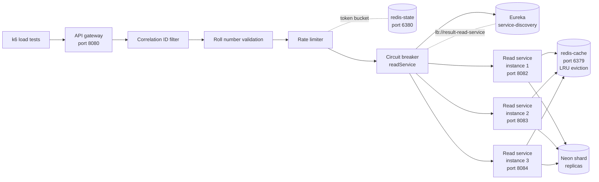
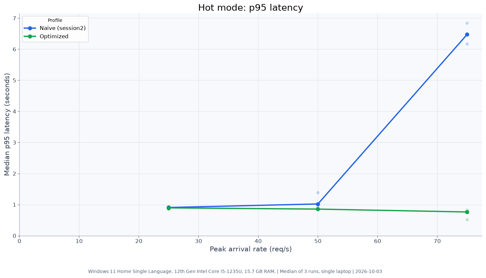
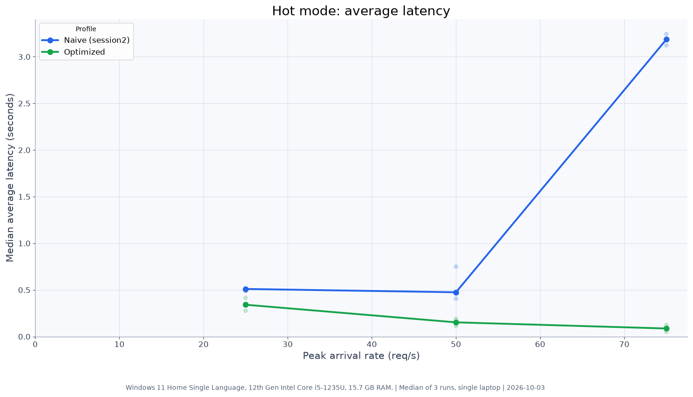

# OU Results: read-path protection for result-day traffic

Result portals can receive a large, sudden wave of lookups when results are published. A database-backed read path that works under normal traffic can become slow or start dropping requests when many students refresh at once. This project uses synthetic OU-style data to compare a direct database read path with a cached read path and to measure gateway protections.

## Architecture

The gateway validates a roll number before rate limiting and forwarding it. It uses a Resilience4j `CircuitBreaker` filter (`readService`) on the route; the auto-configured gateway-level bulkhead was disabled because it silently recorded `BulkheadFullException` as circuit-breaker errors and opened the breaker at 0% failure rate during cold bursts (see [Limitations](#limitations)).

The optimized profile uses Spring `@Cacheable` with a Redis cache manager; lookups use Neon shard replicas. If Redis is unavailable the service falls back to the database. Each shard reader has its own Resilience4j `@Bulkhead` (cap 25, wait 0 ms) and `@CircuitBreaker`. The naive profile bypasses Redis and reads shard primaries directly.

Service instances register with Eureka. The gateway resolves `lb://result-read-service` through Eureka and round-robins across registered instances.

## Headline results

Hot mode repeatedly looks up keys from a fixed set. The values below are copied from the [naive-versus-optimized comparison](./load-tests/results/comparison/README.md).

| Peak rate | Naive p95 / average / dropped | Optimized p95 / average / dropped |
|---:|---:|---:|
| 50 req/s | 1.02 s / 0.47 s / 0.459% | 0.85 s / 0.15 s / 0.000% |
| 75 req/s | 6.48 s / 3.19 s / 19.056% | 0.76 s / 0.09 s / 0.000% |

Those numbers were measured with the earlier hand-written cache implementation which included a per-key Redis lock. The cache is now implemented with Spring's standard `@Cacheable` annotation; the lock has been removed. See the [optimized-v3 results](./load-tests/results/comparison/README.md#optimized-v3-results) for the current implementation's numbers.

### Gateway protection

In the invalid-input scenario, the gateway returned HTTP 400 for all requests; no cache activity was recorded.

For the valid-roll burst, accepted requests produced cache hits and misses as expected; rejected requests (HTTP 429) never reached the read service. See [`load-tests/results/gateway/summary.md`](./load-tests/results/gateway/summary.md) for the current numbers.

### Gateway overhead

The optimized direct and optimized-through-gateway hot runs both had zero errors and dropped iterations in the reported 50 and 75 req/s summaries. The median p95/average values were 0.85/0.15 s direct versus 0.58/0.11 s through the gateway at 50 req/s, and 0.76/0.09 s versus 0.52/0.05 s at 75 req/s. These runs were about ten hours apart, so they do not isolate gateway cost; the observed difference is not evidence that the gateway improves the read path. Treat this as no measurable gateway penalty in these runs, within run-to-run variation, rather than a controlled overhead benchmark. The gateway rate limit was raised to 1000 requests/s with a burst capacity of 2000 because k6 runs from one IP.

## Scaling

One instance sustained 500 req/s of cached repeated lookups through the gateway with p95 around 10 ms after warm-up. The k6 arrival-rate executor could not generate the full 500 req/s because each request completed in roughly 5 ms and k6 hit its own scheduling ceiling at approximately 319 req/s; the single instance was not the bottleneck.

The 1, 2, and 3 instance comparison at 25–75 req/s showed no difference between instance counts because one instance was never stressed at those rates. After cache warm-up all three configurations deliver sub-20 ms p95. Scale-out is not demonstrated on a single laptop. Do not interpret more instances as added capacity based on these results; the test did not find a load level where a single instance saturated.

See [`load-tests/results/comparison/README.md`](./load-tests/results/comparison/README.md) for the full scaling table and charts.

## Limitations

- **Duplicate cold reads:** concurrent requests for an uncached roll number each cause a separate database read. The earlier implementation used a per-key Redis lock to collapse these; that lock was removed when the cache was replaced with Spring `@Cacheable`.
- **Uniform mode gets no cache gain:** each lookup uses a new key, so the cache provides no consistent improvement. At 75 req/s the optimized uniform profile was not better than naive.
- **Bulkhead is a safety net, not shown to improve results:** the per-shard `@Bulkhead` (cap 25, wait 0 ms) caps concurrent database calls and was not observed to improve latency or throughput in the measured runs. It was not shown to reject calls in any of these tests.
- **Hot-mode cache hit ratio was not measured.**
- **Assumed key set:** the 3,000-key hot set is an assumption, not measured OU traffic data.
- **One laptop and free-tier Neon:** results come from one Windows 11 laptop (12th Gen Intel Core i5-1235U, 15.7 GB RAM) and the Neon free tier with shared compute.
- **Hidden gateway bulkhead found and disabled:** Spring Cloud CircuitBreaker auto-configured a `ThreadPoolBulkhead` (cap 25) inside the gateway on top of the circuit-breaker filter. During cold bursts, 25 slow Neon DB calls filled all 25 slots; the resulting `BulkheadFullException` was recorded as a circuit-breaker error and opened the breaker at 0% actual failure rate, causing all remaining requests to get HTTP 503. This was disabled with `spring.cloud.circuitbreaker.bulkhead.resilience4j.enabled=false`.
- **Scale-out not demonstrated:** the test could not find a rate where one instance saturated, so no evidence of capacity gain from additional instances was collected.
- **Naive baseline results varied between sessions.**

## How to run

See [docs/commands.md](./docs/commands.md) for setup, service startup, load tests, and report commands. The result records and charts are under [`load-tests/results/`](./load-tests/results).

## Repository layout

- [`api-gateway/`](./api-gateway/) — gateway validation, rate limiting, and routing.
- [`result-read-service/`](./result-read-service/) — naive and optimized result lookup profiles.
- [`load-tests/`](./load-tests/) — synthetic seed data, k6 scenarios, runners, and reports.
- [`contracts/`](./contracts/) — shared shard map and service contracts.
- [`scripts/`](./scripts/) — local service launch scripts.
- [`docs/`](./docs/) — project phases, trade-offs, and operating instructions.
- [`service-discovery/`](./service-discovery/) — Eureka registry for local service discovery.
- [`result-ingestion-service/`](./result-ingestion-service/) — planned admin upload and ingestion path.
- [`result-persistence-service/`](./result-persistence-service/) — planned write and publish path.
- [`account-service/`](./account-service/) — planned student registration path.
- [`notification-service/`](./notification-service/) — planned result notification and email path.

## Design decisions

- Use two Redis instances: `redis-cache` has LRU eviction for result data; `redis-state` uses no-eviction for rate-limit state.
- Use Spring Cloud Gateway's built-in `RequestRateLimiter` for per-IP rate limiting.
- Validate roll numbers before rate limiting so malformed requests do not consume Redis or read-service work.
- Read ordinary student lookups from shard replicas; keep the naive baseline on shard primaries.
- Disable the auto-configured gateway bulkhead (`spring.cloud.circuitbreaker.bulkhead.resilience4j.enabled=false`) to prevent `BulkheadFullException` from being mis-recorded as circuit-breaker errors.

## Status

Built and measured: the naive primary-read profile, the optimized cached replica-read profile, gateway validation and rate limiting, and k6 load/protection reports.

Implemented in Phase 3: Eureka service discovery, a one-command stack launcher for one or more read instances, per-shard Resilience4j circuit breakers and bulkheads, and a high-rate stress test (150–500 req/s) through the gateway.

Still planned in the phases document: result ingestion, persistence, and the publish saga; then account registration and notification/email services.
