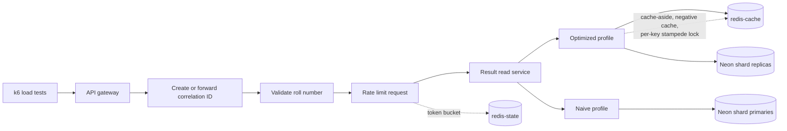

# OU Results: read-path protection for result-day traffic

Result portals can receive a large, sudden wave of lookups when results are published. A database-backed read path that works under normal traffic can become slow or start dropping requests when many students refresh at once. This project uses synthetic OU-style data to compare a direct database read path with a cached read path and to measure gateway protections.

## Architecture

The gateway validates a roll number before rate limiting and forwarding it.
The optimized profile uses Redis cache-aside, short-lived negative caching,
and a per-key lock on cache misses; student lookups use Neon shard replicas.
The naive profile bypasses Redis and reads the shard primaries directly.

## Headline results

Hot mode repeatedly looks up keys from a fixed set. The values below are
copied from the [naive-versus-optimized comparison](./load-tests/results/comparison/README.md).

| Peak rate | Naive p95 / average / dropped | Optimized p95 / average / dropped |
|---:|---:|---:|
| 50 req/s | 1.02 s / 0.47 s / 0.459% | 0.85 s / 0.15 s / 0.000% |
| 75 req/s | 6.48 s / 3.19 s / 19.056% | 0.76 s / 0.09 s / 0.000% |

### Gateway protection

In the invalid-input scenario, the gateway returned HTTP 400 for all 1,001
requests recorded in the report. The read-service cache hit, miss, negative-hit,
and lock-wait counters were unchanged.

For the valid-roll burst, the report records 130 HTTP 200 responses and 871
HTTP 429 responses. Only the 130 accepted requests reached the read-service
counter path; the deltas were 100 hits, 30 misses, zero negative hits, and 29
lock waits. The cold-key burst recorded 30 miss events on one key, with 29
lock waits and 100 hits. The report's accepted-request p95 was 1904.49 ms,
including the cold-key read path.

### Gateway overhead

The optimized direct and optimized-through-gateway hot runs both had zero
errors and dropped iterations in the reported 50 and 75 req/s summaries. The
median p95/average values were 0.85/0.15 s direct versus 0.58/0.11 s through
the gateway at 50 req/s, and 0.76/0.09 s versus 0.52/0.05 s at 75 req/s.
These runs were about ten hours apart, so they do not isolate gateway cost;
the observed difference is not evidence that the gateway improves the read
path. Treat this as no measurable gateway penalty in these runs, within
run-to-run variation, rather than a controlled overhead benchmark. The gateway
rate limit was raised to 1000 requests/s with a burst capacity of 2000 because
k6 runs from one IP.

## Limitations

- Uniform mode showed no cache improvement at 25 and 50 req/s; at 75 req/s the
  optimized profile was not better than naive.
- The 3,000-key hot set is an assumption, not measured OU traffic data.
- The 75 req/s hot runs used a warm cache.
- Naive baseline results varied between sessions.
- The hot-mode cache hit ratio was not measured.
- Results come from one laptop and the Neon free tier.
- The burst's accepted p95 includes the cold key's initial read and lock path;
  it is not a steady-state latency measurement.

## How to run

See [docs/commands.md](./docs/commands.md) for setup, service startup, load
tests, and report commands. The result records and charts are under
[`load-tests/results/`](./load-tests/results).

## Repository layout

- [`api-gateway/`](./api-gateway/) — gateway validation, rate limiting, and routing.
- [`result-read-service/`](./result-read-service/) — naive and optimized result lookup profiles.
- [`load-tests/`](./load-tests/) — synthetic seed data, k6 scenarios, runners, and reports.
- [`contracts/`](./contracts/) — shared shard map and service contracts.
- [`scripts/`](./scripts/) — local service launch scripts.
- [`docs/`](./docs/) — project phases, trade-offs, and operating instructions.
- [`service-discovery/`](./service-discovery/) — planned Eureka service-discovery phase.
- [`result-ingestion-service/`](./result-ingestion-service/) — planned admin upload and ingestion path.
- [`result-persistence-service/`](./result-persistence-service/) — planned write and publish path.
- [`account-service/`](./account-service/) — planned student registration path.
- [`notification-service/`](./notification-service/) — planned result notification and email path.

## Design decisions

- Use two Redis instances: `redis-cache` has LRU eviction for result data; `redis-state` uses no-eviction for rate-limit state.
- Use Spring Cloud Gateway's built-in `RequestRateLimiter` for per-IP rate limiting.
- Validate roll numbers before rate limiting so malformed requests do not consume Redis or read-service work.
- Read ordinary student lookups from shard replicas; keep the naive baseline on shard primaries.
- Use a short-lived per-key lock to prevent concurrent cache misses from stampeding the database.

## Status

Built and measured: the naive primary-read profile, the optimized cached replica-read profile, gateway validation and rate limiting, and k6 load/protection reports.

Still planned in the phases document: Eureka-based scale-out and a waiting room; result ingestion, persistence, and the publish saga; then account registration and notification/email services.
