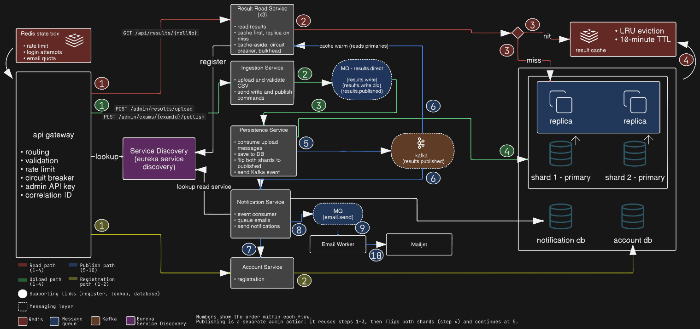

# OU Results Platform — High-Concurrency System Design

## 1. Overview

The OU Results Platform is a system design project exploring how to serve examination results to a large number of students during sudden traffic spikes while allowing administrators to publish new results reliably.

Traditional result portals can experience significant slowdowns when thousands of students access their results simultaneously. This project explores caching, horizontal scaling, database sharding, asynchronous processing, and fault tolerance to address these challenges.

The system separates the read-heavy student experience from administrative result publishing and background processing.

**Core design goals:**

- Serve student result requests with a target p95 latency below 200 ms for cached lookups under the defined workload.
- Handle sudden traffic spikes without overwhelming application servers or databases.
- Allow administrators to upload, validate, and publish result files reliably.
- Keep published results consistent across the database and cache.
- Process notifications and other background tasks asynchronously.
- Demonstrate the trade-offs involved in designing a distributed system.

**Scope:** This is an independently designed system architecture for a university results use case. It is not intended to replace or represent the official OU results portal or its internal workflow. All data used in the project is synthetic.

**How to read this document:** The document describes the target design and marks the state of each part as **Built** (implemented and tested), **Planned** (designed but not yet implemented), or **Not planned** (considered and deliberately left out). Measured results come from a single-laptop test environment and are reported in the results document (`docs/results.md`). They show relative behaviour, not production capacity.

## 2. Requirements

### 2.1 Functional Requirements

1. Students can retrieve examination results using their roll number. *(Built)*
2. Students receive an appropriate response when a result does not exist or has not yet been published. *(Built)*
3. Authorized administrators can upload result files. *(Built; authorization is an API key checked at the gateway)*
4. The system validates uploaded files before publishing results. *(Built)*
5. Administrators can monitor the status of result-processing and publication jobs. *(Built for publication through the status endpoint; for uploads the response returns a batch count, and failed batches can be inspected in the dead-letter queue)*
6. Students can receive notifications when relevant results are published. *(Planned; students who registered an email address receive the result by email)*
7. The system prevents duplicate processing when requests or events are retried. *(Built for uploads and publication; Planned for notification)*
8. Administrators can correct results that have been uploaded but not yet published by uploading the file again. *(Built)* Correcting results after publication is outside the current design (see Section 16).

### 2.2 Non-Functional Requirements

- **Read-to-Write Ratio:** Heavily read-dominated during peak result access, on the order of 100,000:1 for illustration. Writes arrive as occasional bulk uploads.
- **Low Latency:** Target p95 response time below 200 ms for student result retrieval served from the cache. A first lookup that must reach the database depends on the distance to the database; in the test setup, where the database is remote, it took at least about 250 ms.
- **High Availability:** Continue serving requests despite individual component failures wherever possible.
- **Scalability:** Support horizontal scaling of application services to handle sudden traffic spikes.
- **Consistency:** Ensure students receive the correct published result, accounting for cache and database replication delays.
- **Durability:** Persist published results reliably and prevent data loss.
- **Fault Tolerance:** Isolate component failures and prevent cascading failures across services.
- **Burst Traffic Handling:** Protect backend services from overwhelming traffic through rate limiting, admission control, and backpressure.
- **Idempotency:** Prevent duplicate side effects when requests, publication operations, or messages are retried.

These are design targets, not claims of measured production performance. Actual latency and capacity must be validated through load testing. The load tests that have been run are summarized in the results document.

### 2.3 Out of Scope

- Building the university's examination evaluation and grading process.
- Replacing the official university results portal.
- Managing student admissions, attendance, or the complete student information system.
- Student login and session management; lookups use the roll number alone, as on the current university site.
- Downloading results as PDF files, which is a possible future extension.
- Optimizing cloud expenditure as the primary objective.
- Guaranteeing zero downtime or instantaneous global consistency during every failure scenario.

The architecture prioritizes exploring scalability and reliability trade-offs. Infrastructure costs and operational complexity remain relevant limitations even though cost optimization is not a primary project objective.

## 3. Capacity Estimation

Capacity estimation helps determine which components are likely to become bottlenecks.

### 3.1 Assumptions

- A heavily read-dominated workload, illustratively on the order of 100,000 reads for every write at peak.
- A large proportion of student requests target results that have already been published.
- Traffic is highly uneven: ordinary periods have relatively low demand, while result announcements generate concentrated bursts.
- Students repeat lookups: they refresh, and they check the results of friends and classmates. The load tests model this with a fixed set of about 3,000 frequently requested roll numbers, which is an assumption and not measured university data.
- Result publishing occurs much less frequently than result retrieval, roughly once per examination cycle.
- Cache hit rates depend on access patterns and cache capacity.

### 3.2 Read Traffic

As an illustration, consider 50,000 students who each request about five results within ten minutes of an announcement. That is roughly 250,000 requests in 600 seconds, or about 420 requests per second on average. Because arrivals cluster at the moment of announcement, a peak of three to five times the average, around 1,250 to 2,100 requests per second, is a reasonable planning figure.

For comparison, in the single-laptop test environment one read-service instance served 500 requests per second of cached, repeated lookups with a p95 latency of about 10 ms, while the direct-to-database baseline degraded at roughly 54 requests per second. At the high end of the illustrative range, several read-service instances would be needed. Horizontal scaling was not demonstrated in the test environment because a single instance was never saturated.

This does not mean the system receives a uniform stream of writes. Publishing an entire results file may generate a large burst of database writes, cache invalidations, and events.

The architecture therefore treats result publishing as a separate workload rather than assuming that the average write rate captures its actual impact.

### 3.3 Storage Estimation

The main storage requirements include:

- Student registrations and the credential records used to verify them.
- Published results and their associated identifiers, stored as one row per student per semester.
- Examination records, including their publication status.
- Notification records and delivery status.

Actual storage requirements depend on the number of students, examinations, retention policies, and average record size. In the free database tier used for testing, storage is limited per database, which constrains how many examinations can be kept at once.

### 3.4 Peak Traffic

The system must handle correlated requests rather than only average traffic.

If a result announcement causes a sudden increase in demand, simply adding application instances may not be sufficient. The database, cache, network, and connection pools can become bottlenecks.

The design therefore combines caching, controlled traffic admission, horizontal scaling, and database read distribution. In the test environment this combination kept repeated lookups fast at rates where the direct-to-database baseline dropped about 19% of arrivals.

## 4. High-Level Architecture

The system is organized around student result retrieval, administrative publishing, and asynchronous background processing. The diagram below shows the components and the flows between them. Section 4.3 explains how to read it.



### 4.1 Core Components

**API Gateway / Load Balancer** *(Built)*

Provides a common entry point for client requests, routing, rate limiting, and traffic control. It validates roll numbers (format and known college codes), applies per-IP rate limits, protects the read service with a circuit breaker, attaches a correlation ID to each request, and checks an API key on administrative routes. Requests to the read service are balanced across the instances registered in the service registry.

**Waiting Room** *(Not planned)*

An optional admission-control mechanism for extreme traffic bursts. It can queue or defer requests before they reach the main application, protecting the backend at the cost of additional waiting time. The project considered a waiting room and chose simpler protections instead: per-IP rate limiting, per-shard bulkheads, and circuit breakers (Sections 9.4 and 10.1).

**Results Read Service** *(Built)*

Handles student result lookups. Multiple stateless instances can run behind the load balancer, allowing the service to scale horizontally. The service has two profiles: a baseline profile that reads the shard primaries directly with no cache, used as the point of comparison, and an optimized profile that adds the cache, replica reads, bulkheads, and circuit breakers.

**Result Ingestion Service** *(Built)*

Accepts authorized result uploads, validates every row, groups rows by college so that each batch belongs to exactly one shard, and publishes batches of up to 500 rows to RabbitMQ. It is a small, stateless Node.js service.

**Result Persistence Service** *(Built)*

The only service that writes to the shard primaries. It consumes batches from the queue, creates the examination record in draft status on both shards, and writes the rows idempotently. It also coordinates publication (Section 11): it consumes the publish command, runs the publication procedure across both shards, and sends the publication event.

**Redis** *(Built)*

Caches frequently requested results to reduce repeated database reads. Two separate instances are used: one for the cache, which evicts the least recently used entries when memory is full, and one for control state such as rate limits, which must never evict.

**PostgreSQL** *(Built)*

Stores durable application data, hosted on a managed service. The results data layer is split across two shards by college code, and each shard has a primary and a read replica.

**Kafka** *(Built for the publication event; the notification consumer is Planned)*

Distributes the result-publication event to independent consumers: cache warm-up and notification.

**RabbitMQ** *(Built for ingestion and publication; Planned for email)*

Handles task-oriented background jobs, including result ingestion and the publish command and, later, notification delivery, with retries and dead-letter handling.

**Account and Notification Services** *(Planned)*

Separate registration and identity checks from notification delivery, allowing each workload to be scaled and maintained independently.

**Service Discovery** *(Built)*

Eureka registers read-service instances so that the gateway can find them as instances start and stop.

### 4.2 How Services Communicate

Services find each other in three ways:

- **Registry lookup.** The gateway asks Eureka for the current read-service instances and then sends each request directly to one of them. Eureka is a directory and never sits in the request path.
- **Configured addresses.** The Node.js services, Redis, and the databases are reached through addresses set in configuration, because they do not register with Eureka.
- **Message queue.** The ingestion and persistence services communicate only through the `results.write` and `results.publish` queues. Neither needs to know the other's address. Likewise, the read service receives the publication event through Kafka and needs no address for the persistence service.

### 4.3 Reading the Diagram

Line colours show the flow, and the numbers show the order of the steps within each flow. Box colours show the technology: red for Redis, blue for RabbitMQ, brown for Kafka, and purple for Eureka. Dashed boxes are messaging layers. White lines are supporting links, such as service registration and lookup and the connections to the notification and account databases.

Not yet built: the Notification Service, the Email Worker, Mailjet, and the Account Service.

**Read path (red, 1 to 4)** *(Built)*

1. The gateway validates the roll number, applies the rate limit, and sends the request to one of the Read Service instances.
2. The Read Service checks the result cache first.
3. On a hit, the cached result is returned. On a miss, the Read Service reads the replica of the shard that holds the roll number.
4. The result is stored in the cache for later requests.

**Upload path (green, 1 to 4)** *(Built)*

1. The administrator's request passes through the gateway, which checks the API key, and reaches the Ingestion Service.
2. The Ingestion Service validates the file and publishes batches to the `results.write` queue.
3. The Persistence Service consumes each batch. A batch that keeps failing moves to `results.write.dlq`.
4. The Persistence Service upserts the rows into the primary shard that owns the college code, marked as not yet published.

**Publish and email path (blue, 5 to 10)** *(Built up to the cache warm-up; the notification and email steps are Planned)*

Publishing is a separate administrator action. It takes the same route as steps 1 to 3, flips both shards to published (step 4), and then continues:

5. The Persistence Service sends the `results.published` event to Kafka.
6. Kafka delivers the event to two independent consumers at the same time: the Read Service, which warms the cache, and the Notification Service.
7. The Notification Service fetches the registered students from the Account Service.
8. The Notification Service queues one email job per student on `email.send`.
9. The Email Worker takes a job from the queue.
10. The Email Worker sends the email through Mailjet at a controlled rate.

**Registration path (yellow, 1 to 2)** *(Planned)*

1. The student's registration request passes through the gateway to the Account Service.
2. The Account Service stores the registration in the account database.

**Notes**

- The Persistence Service writes to the primary shards only. A publication flips both shards.
- Cache warm-up reads the primary shards, not the replicas, so that it does not copy stale replica data into the cache.
- The Email Worker fetches each result from the Read Service as a strong read on the primary, finding the service through Eureka. It never reads the results database directly.
- The state Redis instance holds the rate limits (gateway), the failed-login counters (Account Service), and the daily email quota (Email Worker).

## 5. API Design

The API is designed around student result retrieval and controlled administrative publishing. Every response, successful or not, uses one envelope with `status`, `statusCode`, `message`, and `data` fields.

### 5.1 Retrieve a Result *(Built)*

`GET /api/results/{rollNo}`

A roll number has twelve digits: a four-digit college code, a two-digit batch year, a three-digit department code, and a three-digit student number. For example, `160423733001` belongs to college 1604, batch 23, department 733, student 001.

Example request:

`GET /api/results/160423733001`

Example successful response (abridged; all data is synthetic):

```
{
  "status": "success",
  "statusCode": 200,
  "message": "Results retrieved successfully.",
  "data": [
    {
      "examId": "2026-jul-aug",
      "title": "B.E. RESULTS - JULY/AUGUST 2026",
      "resultDate": "2026-09-19",
      "rollNo": "160423733001",
      "semester": 6,
      "collegeCode": "1604",
      "name": "ISHAN STUDENT",
      "course": "B.E. (AICTE)",
      "subjects": [
        { "code": "0631", "name": "DEPARTMENT 3 SEMESTER 6 SUBJECT 1", "grade": "A", "credits": 3 },
        { "code": "0632", "name": "DEPARTMENT 3 SEMESTER 6 SUBJECT 2", "grade": "B", "credits": 3 }
      ],
      "resultStatus": "PASSED",
      "sgpa": 8.94,
      "cgpa": null
    }
  ]
}
```

The `data` list contains one entry for each semester published for that roll number.

Possible responses:

- `200 OK`  — Result retrieved successfully. If no published result exists for the roll number, the `data` list is empty.
- `400 Bad Request`  — The roll number is malformed or its college code is unknown. The gateway rejects the request without contacting the read service.
- `429 Too Many Requests`  — The request exceeds the permitted rate.
- `503 Service Unavailable`  — The system cannot safely serve the request, for example because a database circuit breaker is open or the database bulkhead is full. The response carries a `Retry-After` header.

**Access model.** Lookup is by roll number alone, as on the current university site, and there is no student login. Roll numbers follow a predictable pattern, so the gateway validates the format and the known college codes and applies per-IP rate limits to reduce scraping. These are mitigations, not privacy-grade access control. A deployment handling private results would need to authenticate the student and verify authorization (see Section 16).

### 5.2 Upload Results *(Built)*

`POST /admin/results/upload`

Accepts a CSV result file, a title, and a result date from an authorized administrator. The request must carry the administrator's API key in the `X-Admin-Api-Key` header, which the gateway checks before forwarding the request.

Example response:

```
{
  "status": "success",
  "statusCode": 200,
  "message": "Results uploaded and queued successfully",
  "data": {
    "examId": "2026-jul-aug",
    "totalRows": 5001,
    "batchesPublished": 11,
    "collegesCount": 2
  }
}
```

The upload returns as soon as the file has been validated and queued, so the administrator does not have to wait for the rows to be written. Persistence completes asynchronously. Rows are stored as unpublished and are not visible to students.

### 5.3 Check Publication Status *(Built)*

`GET /admin/exams/{examId}/publish-status`

Reads both shards and reports the state of the publication procedure: `DRAFT`, `PUBLISHING`, `SHARDS_PUBLISHED`, `PUBLISHED`, or `FAILED`. A publication that is stuck in `SHARDS_PUBLISHED` indicates that the results are live but the publication event has not yet been sent. If the two shards report different states, the overall status follows the rule in Section 11.

### 5.4 Publish Results *(Built)*

`POST /admin/exams/{examId}/publish`

Initiates publication after the upload has been checked. Publication is idempotent by design: each state change is conditional, so repeating the command for an examination that is already published has no further effect, and a retried command resumes from the recorded state instead of creating a duplicate publication. The request passes through the gateway to the ingestion service, which sends the command to the queue and returns at once without waiting for the procedure to finish.

## 6. Database Design

The database layer separates different data responsibilities while maintaining clear ownership of each record type.

### 6.1 Account Database *(Planned)*

**Purpose:** Store the email address each student registers for result delivery, and the credential records used to verify that the student owns the roll number.

Tables:

- `registrations` (roll number as the primary key, email, creation time)
- `student_credentials` (roll number as the primary key, password hash)

Important considerations:

- Enforce one email address per roll number. Registering again replaces the address and requires the credentials again.
- Store only password hashes. The credential records stand in for the college-issued passwords; in a real deployment this check would call the college's own system.
- Limit brute-force guessing with failed-attempt counters kept in Redis, per roll number and per IP address.
- Avoid storing unnecessary student data.
- Administrative access uses an API key checked at the gateway. The project does not use accounts, roles, or sessions.

### 6.2 Results Database *(Built)*

**Purpose:** Store durable examination results and their publication state.

Tables on each shard:

- `results`
- `exams`

A result row represents one student in one semester and contains:

- Examination identifier, roll number, and semester.
- College code, batch year, and department code, parsed from the roll number.
- Student name, father's name, gender, course, and medium.
- Subject-wise grades and credits, stored as a JSON array in the same row.
- Result status, SGPA, and CGPA.
- A published flag and the upload timestamp.

The unique key is the combination of examination, roll number, and semester. A roll number can have several rows in one examination, for example for backlog semesters.

The `exams` table is copied to each shard and records the examination title, the result date, and its publication status (`DRAFT`, `PUBLISHING`, `SHARDS_PUBLISHED`, `PUBLISHED`, or `FAILED`). Result rows reference their examination through a foreign key on the same shard.

**Denormalized rows:** Subjects are stored inside the result row rather than in a separate table. A lookup is then a single indexed read, and the whole row can be cached as one value. Because published results do not change, the duplication does not create an update problem.

**Sharding:** Result records are distributed across two shards by college code, using a static shard map. All rows for a student live on one shard, so a lookup touches one database. A static map is simple to operate but cannot rebalance automatically: adding a shard would require migrating data and changing the publication procedure, which is built for exactly two shards.

**Read replicas:** Each shard has a primary and a read replica. Student lookups read from the replica on a cache miss, and replication lag is accepted for them. Internal readers that need the newest data immediately after publication, namely the cache warm-up and, later, the email worker, read the primary instead (a strong read, *Built*).

Sharding and read replicas solve different problems: sharding distributes data and write load, while replicas primarily distribute read load and can provide an additional recovery mechanism.

### 6.3 Notification Database *(Planned)*

**Purpose:** Track notification delivery independently of the result records.

Table:

- `email_log` (roll number, examination, email address, status, attempt count, time sent)

The combination of roll number and examination is unique, which makes the table the idempotency record: a student receives at most one email per examination, even if jobs are redelivered. The status moves between `PENDING`, `SENT`, and `FAILED`.

Notification failures should not roll back a successfully published result.

## 7. Caching Strategy

Redis reduces repeated database queries for popular results.

### 7.1 Cache-Aside Pattern *(Built)*

1. The student requests a result.
2. The read service checks Redis.
3. If the result exists, it returns the cached value.
4. If the result is missing, the service queries PostgreSQL.
5. The service caches the retrieved result and returns it.

This approach keeps the database as the source of truth while allowing frequently accessed records to be served quickly. The implementation uses the framework's standard caching annotation on the read method, backed by Redis. On a miss, the database read goes to the replica of the shard that holds the roll number.

### 7.2 Cache Keys

A cache key identifies the roll number being requested, for example `result::160423733001`. One entry holds the list of all published results for that roll number. Published results do not change, so versioned keys are not used. If republication were introduced, versioned keys or explicit invalidation would be needed.

### 7.3 Cache Invalidation

When new results are published, the system must ensure that older cached values do not remain authoritative.

Possible approaches include:

- Invalidating affected keys after the database transaction commits.
- Publishing invalidation events to cache consumers.
- Using versioned cache keys and updating the active result version.
- Applying TTLs as a fallback against indefinitely stale entries.

The current implementation relies on a ten-minute TTL and on a warm-up step on the publication event, which overwrites the entries for the newly published examination (Section 11). TTL alone does not guarantee immediate consistency.

### 7.4 Negative Caching

Lookups that find no result return an empty list, which is cached under the same ten-minute expiry as successful lookups, to reduce repeated database reads for nonexistent results. The first, hand-written implementation used a shorter 30-second expiry for these entries; the current implementation uses a single expiry for simplicity.

Negative cache entries must also be replaced when the corresponding result is published. Otherwise, a student who looked up a result before publication could see it as missing for up to ten minutes afterwards. The cache warm-up on the publication event overwrites those entries. In testing, a student who looked up a result before publication received the result afterwards.

### 7.5 Cache Stampede Prevention

When a popular key is cold or expires, many simultaneous requests may attempt to retrieve the same record from the database.

The first implementation used a per-key Redis lock to let one request load the value while the others waited. It was removed in favour of the standard caching annotation. The framework's synchronized-loading option had no effect on the Redis cache in testing: 30 simultaneous requests for one uncached roll number caused 30 database reads. The current implementation therefore accepts duplicate database reads for a cold key and limits their impact in other ways.

Mitigations considered:

- **Controlled database concurrency** *(Built)*: a bulkhead caps concurrent database reads at 25 per shard and rejects the excess immediately with a 503 and a `Retry-After` header. In a burst of about 1,000 requests for one uncached roll number, 947 succeeded and 53 were rejected with a 503. The cache counters showed 922 hits and 78 misses, which is consistent with 25 database reads and 53 bulkhead rejections among the misses. The bulkhead's own rejection counter was not recorded, so this is inferred from the counts.
- **Cache warm-up at publication** *(Built)*: filling the cache before students arrive means that few lookups meet a cold key.
- **Request coalescing or per-key locking** *(Not implemented; removed as described above)*.
- **TTL jitter** and **background refresh for selected hot keys** *(Not implemented)*.

### 7.6 Redis Failure *(Built)*

Redis should be treated as a performance layer, not the only copy of result data. If the cache becomes unavailable, the system falls back to PostgreSQL: a small error handler logs a warning and lets the lookup continue. In testing, a lookup with Redis stopped still returned its result, and the cache resumed working when Redis was restarted.

Unrestricted cache bypass could overwhelm the database, so rate limiting, the database bulkhead, and circuit breakers remain important.

## 8. Asynchronous Processing

Background processing prevents expensive work from extending the latency of student-facing requests.

### 8.1 Kafka Event Streaming *(Built)*

Kafka distributes a domain event after publication completes.

Example event:

```
{
  "eventId": "evt-19281",
  "eventType": "results.published",
  "examId": "2026-jul-aug",
  "occurredAt": "2026-10-10T10:00:00Z"
}
```

Consumers:

- Cache warm-up in the read service.
- Notification orchestration.

Further consumers, such as analytics, could be added later without changing the publisher. In the current plan `results.published` is the only Kafka topic.

Kafka allows multiple independent consumer groups to process the same publication event without coupling their execution to the publishing request.

Consumers should be idempotent because messages can be delivered or processed again after failures.

### 8.2 RabbitMQ Task Queue *(Built for ingestion)*

RabbitMQ handles discrete background jobs:

- **Result batches** *(Built)*: the ingestion service sends batches of up to 500 rows, grouped by college so that each message maps to one shard, on the `results.write` queue. The persistence service consumes them.
- **Publish command** *(Built)*: acknowledged only after the publication event has been sent.
- **Email jobs** *(Planned)*: sent at a controlled rate that respects the provider's quota.

File parsing and validation happen in the ingestion service before anything is queued. The queues, the exchange, and the dead-letter queue are declared in a definitions file loaded by the broker, so neither application declares them.

Workers acknowledge jobs only after the required processing step succeeds. A failing batch is retried three times with backoff and is then rejected without requeue, which routes it to `results.write.dlq` for inspection. Retry limits and dead-letter queues help isolate repeatedly failing tasks.

### 8.3 Why Both Kafka and RabbitMQ?

They solve related but distinct problems.

| Kafka | RabbitMQ |
| ----- | ----- |
| Durable event stream | Task-oriented message queue |
| Multiple independent consumer groups | Worker queues and task distribution |
| Retained events can be replayed according to retention policy | Jobs are typically acknowledged and removed from the queue |
| Useful for event-driven integrations and analytics | Useful for task retries and dead-letter handling |

Using both systems introduces additional infrastructure, monitoring, and operational complexity. Their coexistence is justified only when the application needs both retained event streams and task-oriented job handling. A simpler deployment could use one messaging technology for an initial version.

In this project Kafka carries a single event, intended for two independent consumer groups: cache warm-up (built) and notification (planned). A RabbitMQ fan-out exchange could carry that event as well. Kafka is kept to demonstrate consumer groups and event retention, and it is the first component to remove if the design needs to be simplified.

### 8.4 Reliable Event Publishing

A database update and a message publication are not automatically atomic. If the database commits but the event is never published, downstream consumers may not learn that results have changed.

A transactional outbox is a standard solution when one database holds the data:

1. Commit the result changes and an outbox record in the same database transaction.
2. A publisher reads pending outbox records.
3. The publisher sends the corresponding events.
4. Successfully published records are marked as processed.
5. Consumers deduplicate events using stable identifiers.

It does not close the gap here by itself, because the results are split across two shards and an outbox record can join only one shard's transaction. The publication procedure therefore uses a saga with idempotent steps (Section 11). The publish command is acknowledged only after the event has been sent, so a crash leads to redelivery and the procedure resumes from its recorded state. The event may be sent twice, which is safe because consumers are idempotent.

## 9. Load Balancing and Horizontal Scaling

### 9.1 Load Balancing *(Built)*

The gateway distributes requests across healthy read-service instances using the Eureka registry. Instances register when they start, and only instances that report themselves healthy receive traffic. In testing, requests rotated evenly across three instances.

### 9.2 Horizontal Scaling

The results read service is stateless, allowing additional instances to be started as demand increases.

Scaling decisions should consider more than CPU utilization, including:

- Request rate and latency.
- Active requests and connection counts.
- Redis and database load.
- Queue depth and message-processing lag.
- Error rates and available database connections.

In the test environment, scale-out was not demonstrated. One instance sustained 500 requests per second of cached lookups, so one, two, and three instances produced the same results, and on a single laptop all instances share the same processor as the load generator, the gateway, and Redis.

### 9.3 Rate Limiting *(Built)*

Rate limits restrict abusive or excessive request patterns and help protect downstream services.

The gateway applies a token-bucket limit per client IP address, backed by Redis, with defaults of 10 requests per second and a burst of 30. In a test from one address, a burst of 1,001 requests at 100 per second was cut down to 121 admitted requests, and the remainder received a 429. Limits can be applied by IP address, authenticated account, or another appropriate identity. Shared NATs, such as college networks, and legitimate bursts must be considered when choosing limits. The limits are configurable, and they are raised for load tests that originate from a single address.

### 9.4 Admission Control and Backpressure

A waiting room can limit the number of requests admitted during extreme traffic spikes. The project designed one and chose not to build it. It uses three simpler mechanisms instead:

- Per-IP rate limiting at the gateway.
- Per-shard bulkheads in the read service, which cap concurrent database reads and reject the excess immediately with a retry hint.
- Circuit breakers, which stop calls to a dependency that is failing.

The cost of this choice is that there is no queue position or ordering: a rejected student retries instead of waiting in line.

Background workers should also use backpressure: when downstream databases or external providers are struggling, processing should slow down rather than continuously adding more work. The email worker is planned to pace its sends to the provider's rate and daily quota.

The trade-off is straightforward: controlled throttling preserves system stability but can reduce immediate throughput and increase the number of retries.

## 10. Reliability and Fault Tolerance

### 10.1 Circuit Breakers *(Built)*

Circuit breakers temporarily stop calls to a failing dependency after repeated failures. This prevents application threads and connection pools from being exhausted by requests that are unlikely to succeed.

The read service has one breaker per shard around its database reads, and the gateway has a breaker around the read service. In testing, with one shard made to fail, requests for that shard failed fast with a 503 while the other shard continued to serve. With the read service stopped, the gateway breaker opened after about ten failed calls and answered subsequent requests in about 24 ms.

One configuration detail is worth recording: the circuit-breaker library adds a default bulkhead of 25 concurrent calls inside the gateway. Under a burst it rejected requests and tripped the gateway breaker even though the read service was healthy. It was disabled, and the real concurrency limit now lives in the read service, next to the database.

### 10.2 Timeouts and Retries

Every network call should have a suitable timeout. Retries should be limited, use backoff, and apply jitter to avoid synchronized retry storms.

The gateway applies a ten-second timeout to read-service calls, and the queue consumer retries a failing batch three times with backoff. Retries are safe only when the operation is idempotent or otherwise protected against duplicate effects.

### 10.3 Database Failures

If a database instance becomes unavailable, the system should fail over where supported or return a controlled error rather than pretending that a result is available.

Read replicas can support recovery designs, but replication and failover procedures must be configured and tested separately. The managed database used here provides replicas, but failover was not configured or tested in this project.

### 10.4 Message Processing Failures *(Built for the write path)*

Failed jobs should be retried according to a bounded policy. Jobs that repeatedly fail should move to a dead-letter queue for inspection and controlled redelivery. In testing, a corrupted message was retried three times and then appeared in `results.write.dlq`.

### 10.5 Graceful Degradation

If notification processing or analytics fails, student result retrieval should remain available whenever its required dependencies are healthy.

The architecture isolates optional background workloads from the synchronous read path to reduce the impact of partial failures. In testing, lookups continued to return results with Redis stopped, and one failing shard did not affect the other.

### 10.6 Idempotency

Uploads, publication commands, event consumers, and notification workers should use stable identifiers or deduplication records to prevent duplicate side effects during retries.

For uploads *(Built)*, rows are written with an upsert on the examination, roll number, and semester. An upload timestamp guard means that an older redelivered batch cannot overwrite newer data, and a re-upload never resets the published flag. Publication steps are conditional (*Built*), and the email log is unique per roll number and examination (*Planned*).

Idempotency does not automatically guarantee exactly-once execution across distributed services; it provides a way to make repeated processing safe.

## 11. Result Publishing Workflow

Result publishing is the primary write workflow and requires stronger coordination than ordinary cache reads. Steps 1 to 6 are built; step 7 (notification) is planned.

### Step 1: Administrative Upload *(Built)*

An authorized administrator submits a results file. The gateway checks the API key and forwards the request to the ingestion service.

### Step 2: File Validation *(Built)*

The ingestion service validates the file format, required fields, and the type of each value before any batch is queued. It groups the rows by college code, so that each batch belongs to exactly one shard, and splits them into batches of up to 500 rows.

### Step 3: Draft Persistence *(Built)*

The ingestion service publishes each batch to RabbitMQ and returns to the administrator. The persistence service consumes each batch, creates the examination record in draft status on both shards if it does not exist, routes the batch to the shard that owns its college code, and upserts the rows with the published flag set to false. A batch that keeps failing is moved to the dead-letter queue. Until publication, students cannot see the uploaded rows.

### Step 4: Publication Command *(Built)*

The administrator publishes the examination. The ingestion service sends a `results.publish` command to RabbitMQ, and the persistence service runs the publication procedure.

### Step 5: Publication Procedure *(Built)*

Two shards cannot share one database transaction, so publication is an orchestrated saga of idempotent local steps:

1. Set the examination status to `PUBLISHING` on both shards.
2. Publish the rows on shard 1 by setting the published flag where it is not yet set.
3. Publish the rows on shard 2 in the same way. When both are done, the status becomes `SHARDS_PUBLISHED`. The results are now live, and this is the point of no return.
4. Send the `results.published` event, set the status to `PUBLISHED`, and then acknowledge the command.

Failure rules:

- If step 2 or 3 fails, retry with backoff. The flips are idempotent.
- If it still fails, undo the flips already made, set the status to `FAILED`, and log the failure.
- Once both shards are published (`SHARDS_PUBLISHED`), the procedure is never undone. The results are valid, so it only moves forward.
- If step 4 fails or the process stops at any point, the command is not acknowledged, so RabbitMQ redelivers it and the procedure resumes from the recorded status.
- The event is sent synchronously, and the procedure waits for the broker's acknowledgement before setting `PUBLISHED`. If sending fails after all retries, the command moves to a dead-letter queue and the examination stays at `SHARDS_PUBLISHED`. Sending the publish command again completes it.
- The event may be sent twice. Consumers are idempotent, so this is safe.
- Each shard keeps its own status, so after a crash the two can disagree. The rule is that if either shard has reached `SHARDS_PUBLISHED` or `PUBLISHED`, the examination has passed the point of no return, and the procedure only moves forward by finishing the lagging shard. Only when neither shard has reached that point can a failure roll back.

Two configuration flags make the failure paths demonstrable: one makes a chosen shard fail, which shows the rollback in the logs, and one makes event sending fail, which shows the stuck and recovered case. In testing, a forced shard 2 failure rolled shard 1 back and left both shards `FAILED` with no result visible to students. A process killed just after the point of no return was redelivered the command and completed without duplicate writes. A forced event failure left the examination at `SHARDS_PUBLISHED` until the command was sent again.

### Step 6: Cache Warm-Up *(Built)*

The read service consumes the `results.published` event and fills the cache for the newly published examination. It reads the primary shards in pages, which avoids stale replica data and avoids overloading the primaries, and it overwrites any cached not-found entries. Students who arrive after the announcement then find a warm cache. The pages are 200 rows with a short pause between them, and the entries are written through the framework's cache annotation. In testing, the cache entries were present in Redis for students on both shards.

The read service also has an internal strong-read endpoint that reads the primary directly. It is not routed through the gateway, which answers 404 for it.

### Step 7: Notification *(Planned)*

The notification service consumes the same event and fetches the students who registered an email address before publication. It creates one job per student containing only the roll number, email address, and examination, never the result itself. For each job a worker fetches the result with a strong read, builds the email, and sends it at a controlled rate that stays under the provider's daily quota. The email log keeps each student to one email per examination, failed sends are retried with backoff and then dead-lettered, and a failed email never undoes a published result.

## 12. Consistency and Concurrency

### 12.1 Source of Truth

PostgreSQL is the authoritative store for published results. Redis and messaging systems support performance and asynchronous processing; they are not substitutes for durable result records. Even the state of the publish workflow (Section 11) is kept in PostgreSQL, so it survives a Redis or broker restart.

### 12.2 Cache Consistency *(Built)*

The system must define how quickly changes become visible after publication. Invalidation events, versioned keys, and bounded TTLs help manage stale data, but they do not independently guarantee zero propagation delay.

The current implementation relies on a bounded ten-minute TTL, so a stale or not-found entry can remain visible for up to ten minutes. The warm-up step overwrites the entries for a newly published examination as soon as the publication event is processed (Sections 7.3 and 11). Versioned keys are not used, because published results do not change (Section 7.2).

### 12.3 Replica Consistency

Read replicas may lag behind the primary. Immediately after publishing a result, a read routed to a lagging replica may not see the latest version. This matters in this design because the student read path deliberately uses the replicas. Replica lag has not been measured in any test run, so the size of the delay is not yet known.

Possible mitigations include routing publication-sensitive reads to the primary, waiting for replication to reach a required position, or using version-aware routing.

The design chooses the first. Student lookups stay on the replicas and accept a short delay. Publication-sensitive reads go to the primary: the cache warm-up uses the strong-read path described in Section 11 *(Built)*, and the notification worker will use it *(Planned)*. Waiting for a replication position and version-aware routing are not used, because they add complexity that the primary-read approach avoids.

### 12.4 Concurrent Publishing *(Built)*

Two administrators may attempt to publish results for the same examination concurrently.

The system can prevent conflicting publication operations using database constraints, optimistic locking, publication-version checks, and idempotency keys.

In this design the protection comes from conditional state changes in PostgreSQL. A publish command only moves an examination out of its current status if that status allows it, and the flip on each shard only touches rows that are not yet published. A second publish for the same examination therefore finds the work already in progress or done and has no further effect. Optimistic locking and separate idempotency keys are not used.

The upload path is already protected in a similar way *(Built)*. Rows are keyed by examination, roll number, and semester, and an upsert only replaces a stored row when the incoming one is newer. Uploading the same file twice, or two files that overlap, does not create duplicates or let an older upload overwrite a newer one.

### 12.5 CAP Trade-offs

The CAP theorem describes the trade-off between consistency and availability when a distributed system experiences a network partition.

For this platform, the design prioritizes correctness of published results over returning potentially conflicting versions during a partition. Depending on the failure and operation, some requests may need to wait or fail rather than return stale or inconsistent data.

The two main paths behave differently. Publishing favours consistency: if one shard cannot be updated before the point of no return, the workflow rolls back instead of leaving one shard published and the other not. Student reads favour availability: they may be served from the cache or a replica that is slightly behind, and if the cache is unavailable the service falls back to the database. When a shard itself is unreachable, reads for that shard fail fast with a 503, while the other shard keeps serving.

This is not a blanket claim that the entire system is simply "CP" or "AP." Different components and operations can have different consistency and availability behaviors.

## 13. Observability and Monitoring

A distributed system needs enough telemetry to identify where latency and failures originate. At the moment only part of this is in place; each subsection says which part.

### 13.1 Logging *(Partly built)*

Use structured logs with request IDs, job IDs, publication IDs, and event IDs. Avoid logging sensitive student data unnecessarily.

The gateway generates a correlation ID for every request and passes it to the services behind it. At the moment the ID appears in the gateway and read service logs, but not in the ingestion or persistence logs, and it is not carried in queue messages. The ingestion service writes structured JSON logs, while the Spring services write formatted plain text. Job, publication, and event identifiers in the logs are *Planned*. The services built so far do not handle email addresses; when the notification pipeline is built, full addresses will not be logged.

### 13.2 Metrics *(Partly built)*

Monitor:

- Request throughput and latency percentiles.
- HTTP error rates and rate-limit rejections.
- Cache hit ratio, evictions, and memory usage.
- Database query latency, connection utilization, and replication lag.
- Kafka consumer lag and event-processing failures, if Kafka is adopted for the publication event.
- RabbitMQ queue depth, retry counts, and dead-letter volume.
- Upload processing time and publication success rates.
- Notification delivery outcomes.

The read service exposes cache hit and miss counters, circuit-breaker and bulkhead states and events, database connection pool metrics, and JVM metrics through its management endpoints, and the ingestion service exposes process memory. The load tests record throughput, latency (average, median, p90, and p95), and error rates. A metrics dashboard is not built.

### 13.3 Distributed Tracing *(Not planned)*

Trace requests across the gateway, read service, cache, and database. For background work, propagate correlation identifiers across message boundaries where practical.

Full distributed tracing is not planned. The correlation ID follows a request from the gateway to the read service, which is enough to join the logs of those two services for one request. It is not yet carried through queue messages or into the ingestion and persistence logs; doing so is planned.

### 13.4 Alerting *(Not planned)*

Alerts should identify actionable failures, such as sustained latency increases, database saturation, growing queues, excessive consumer lag, and repeated publication failures.

Monitoring should distinguish normal result-announcement spikes from a genuine service outage.

## 14. Load Testing and Performance Evaluation

Performance targets must be validated experimentally rather than inferred from the architecture.

### 14.1 Test Scenarios

| # | Scenario | Status |
|---|---|---|
| 1 | Normal result retrieval with a warm cache. | Done |
| 2 | Result retrieval with a cold cache. | Done |
| 3 | A sudden spike in requests for popular roll numbers. | Done |
| 4 | A large proportion of nonexistent result requests. | Partly done: malformed roll numbers are rejected at the gateway, and about 5% of requests in every run used valid-format roll numbers that do not exist |
| 5 | Cache unavailability and controlled fallback to PostgreSQL. | Not yet run (the fallback handler exists but has never been exercised in a test) |
| 6 | Database latency increases or replica lag. | Not yet run (a failing shard was tested; replica lag has never been measured) |
| 7 | Large result-file uploads during active student traffic. | Not yet run |
| 8 | Background notification backlogs. | Planned, with the notification pipeline |
| 9 | Recovery after an application instance or worker fails. | Partly done: queued messages survived a broker restart, and the persistence worker, killed just after the point of no return, resumed and completed after restart; failover of a read-service instance has not been tested |

### 14.2 Baseline vs. Optimized Architecture

Compare a baseline implementation against the optimized design under equivalent workloads.

Measure:

- Throughput.
- p50, p95, and p99 latency.
- Error rate.
- Cache hit ratio.
- Database query volume and utilization.
- Queue depth and processing delay.
- Recovery time after injected failures.

The baseline and optimized read paths have been compared under the same workloads, measuring throughput, latency (average, median, p90, and p95), error and dropped-request rates, and cache hits and misses. The 99th percentile is not recorded because the k6 summary was not configured for it. Database query volume, queue depth, and recovery time have not yet been measured.

### 14.3 Load Testing Tools *(Built)*

Use k6 to generate repeatable workloads, including gradual ramp-up, sustained load, and sudden bursts.

Record the test environment, data volume, workload distribution, and cache state so that results can be reproduced.

Each run is saved with the machine specification, date, workload mode, and request rate, under `load-tests/results/`.

### 14.4 Success Criteria

The primary target is p95 read latency below 200 ms under the defined test workload, with an acceptable error rate and no uncontrolled database or queue saturation.

The project should report actual measured results, including cases where the target is not met. Results from a local machine or limited test environment should not be presented as production capacity guarantees.

Measured against this target, the results so far are mixed. With a warm cache, one instance served 500 requests per second with a p95 of about 10 ms. At 300 requests per second, three repeated runs gave p95 values of 392, 368, and 8.6 ms, The warm-up step before each run pre-loaded only two roll numbers, so the hot set of 3,000 cached results, and the connection pools, filled during the first two runs and were fully warm only in the third. The 8.6 ms figure is therefore the warm-cache result, and the other two show what a partly warm cache costs. The target was met only once the cache was fully warm. A repeat of the warm run after the publishing work was added to the system (with the Kafka consumer and warm-up worker active) gave a p95 of 15.87 ms and a median of 3.97 ms, with no errors and no dropped requests. That is slower at p95 than the 8.60 ms run, but well inside the 200 ms target, and it is a single run on a laptop, so the difference is within the run-to-run variation seen earlier. When every lookup requested a new roll number, the cache gave no benefit and p95 was several seconds. The direct-to-database baseline exceeded the target at much lower rates and collapsed at 75 requests per second.


## 15. Trade-offs and Design Decisions

### 15.1 Caching vs. Direct Database Reads

Caching reduces repeated database access and improves latency for popular results. However, it adds invalidation complexity, memory requirements, and potential staleness.

In the test environment, with a warm cache one instance served 500 requests per second with a p95 of about 10 ms. The direct-to-database baseline degraded at about 54 requests per second and dropped about 19% of arrivals at 75 requests per second. When every lookup requested a new roll number, the cache gave no benefit, and the optimized path was not better than the baseline at 75 requests per second.

### 15.2 Sharding vs. a Single PostgreSQL Database

A single database is simpler to operate and may be sufficient for a large range of workloads. Sharding can increase capacity but introduces routing, rebalancing, and cross-shard coordination.

Sharding should be justified by measured database constraints, not just a projected request count. In this project it is not justified by measurement: the data set is small enough for a single database. Sharding by college code is included to demonstrate routing and the coordination it requires, such as the publication saga, and it cannot rebalance automatically.

### 15.3 Kafka vs. RabbitMQ

Kafka is suited to retained event streams and multiple independent consumers. RabbitMQ is suited to task distribution, acknowledgements, and retry-oriented job handling.

Using both supports different workload patterns but increases operational complexity. Here Kafka carries one event and could be replaced by a RabbitMQ fan-out exchange.

### 15.4 Synchronous vs. Asynchronous Processing

Synchronous processing gives immediate outcomes but increases request latency and couples the request to downstream dependencies.

Asynchronous processing improves isolation and burst handling but introduces eventual completion, retries, duplicate delivery concerns, and additional job-status management. In this project an upload returns after validation and queuing, and persistence failures become visible in the dead-letter queue and not in the upload response.

### 15.5 Read Replicas vs. Cache

Read replicas distribute database queries while retaining database query semantics. Redis can serve repeated values with much lower overhead, but cached values require explicit freshness management.

They complement each other rather than being interchangeable. Student lookups use the replica on a cache miss, while internal readers that need the newest data after publication use the primary.

### 15.6 Waiting Room vs. Unrestricted Admission

Unrestricted admission provides immediate access until the system becomes overloaded. A waiting room protects the backend but can introduce queues, delays, and more complicated user experience.

In this project a waiting room was designed and then replaced by per-IP rate limiting, per-shard bulkheads, and circuit breakers. They are simpler to explain and operate, at the cost of queue position and fairness: excess requests are rejected immediately with a retry hint instead of waiting in line.

### 15.7 Microservices vs. a Simpler Deployment

Separating services allows independent scaling and fault isolation, but increases deployment, networking, monitoring, and debugging overhead.

A simpler deployment, for example a gateway, a single results service, and a notification worker, could serve the measured workload. The project demonstrates a distributed architecture; it does not assume that this architecture is the cheapest or simplest solution for every university.

### 15.8 Standard Framework Features vs. Hand-Written Infrastructure

The first version of the cache was written by hand, with explicit Redis reads and writes, a per-key lock, and a retry loop. It was replaced by the framework's standard caching annotation and a short configuration. The result is far less code to explain and maintain, at the cost of the stampede protection described in Section 7.5. The standard approach was chosen because the lost protection can be limited by the bulkhead and by cache warm-up, while the hand-written logic carried most of the complexity of the read service.

## 16. Limitations and Future Improvements

### 16.1 Limitations

- The architecture is a design and implementation exercise, not proof of production-scale operation.
- All measurements come from one laptop, a remote free-tier database, and an assumed set of frequently repeated roll numbers. They show relative behaviour and not capacity.
- Actual capacity depends on workload characteristics, infrastructure, database configuration, and cache hit rate.
- Horizontal scale-out and instance failover were not demonstrated. One instance was never saturated, and no instance was stopped while others served traffic.
- Sharding uses a static shard map, so there is no automatic rebalancing, and the publication procedure is built for exactly two shards.
- Sharding and replication introduce operational complexity.
- Redis and event consumers can temporarily expose stale state unless publication and consistency rules are carefully enforced. Cached not-found entries can persist for up to ten minutes until the warm-up replaces them.
- Results cannot be corrected after publication in the current design.
- A first lookup of a cold roll number can cause duplicate database reads, which are limited by the bulkhead but not eliminated.
- When every request asks for a new roll number, the cache gives no benefit, and the optimized path was not better than the baseline at 75 requests per second. This was measured before the later resilience fixes and has not been repeated.
- Uploads are processed in memory with a configured size cap (50 MB in the current configuration). Very large files, such as a 100,000-row examination, are outside what has been tested and would need disk-based handling and streaming.
- Lookups use the roll number alone, with validation and rate limiting as mitigations. They are not privacy-grade access control.
- Kafka and RabbitMQ increase infrastructure and maintenance requirements when both are deployed.
- There is no waiting room. Overload is handled by rejecting excess requests quickly.
- High availability depends on deployment topology, failure detection, backups, and tested recovery procedures.

### 16.2 Future Improvements

- Validate architecture choices using realistic workload measurements before increasing infrastructure complexity.
- Complete and test the publication procedure, strong reads, cache warm-up, and idempotent event consumers.
- Measure failover by stopping one of several read-service instances, and repeat the all-new-roll-number tests after the resilience fixes.
- Support disk-based, streaming uploads for very large result files.
- Automate database backup restoration and disaster-recovery testing.
- Add publication reconciliation jobs to detect inconsistencies between stored data and downstream processing.
- Improve adaptive admission control based on backend health.
- Evaluate whether some services or messaging components can be consolidated without compromising required behavior.
- Define explicit service-level objectives and recovery-point and recovery-time objectives.
- Evaluate privacy, authentication, authorization, and audit requirements before any real deployment.

## Conclusion

The OU Results Platform explores how a read-heavy application can combine caching, horizontally scaled services, PostgreSQL, asynchronous messaging, and fault-tolerance patterns to handle concentrated demand.

Its central design challenge is not simply serving a large number of reads. It is maintaining a reliable result-publishing workflow while keeping student-facing retrieval responsive, even when individual components are slow or unavailable.

In the implemented read path, caching, replica reads, a gateway with rate limiting, and circuit breakers kept repeated lookups fast at rates where the direct-to-database baseline degraded. The publishing workflow, including the two-shard publication procedure, its failure handling, and the cache warm-up, is built and tested; the registration and email pipeline is planned.

The design is successful only to the extent that its assumptions and performance targets are validated through testing and that the added complexity of distributed infrastructure is justified by the workload.