# Examination Results Processing & Delivery Workflows

## Table of Contents
- [Workflow 1: Result Read Service (Read Path)](#workflow-1-result-read-service-read-path)
  - [Scenario 1: Naive Direct Database Access (Baseline Failure Mode)](#scenario-1-naive-direct-database-access-baseline-failure-mode)
  - [Scenario 2: Cache Hit (Warm Cache with Redis)](#scenario-2-cache-hit-warm-cache-with-redis)
  - [Scenario 3: Cache Miss (Database Fallback with Bulkhead & Circuit Breaker)](#scenario-3-cache-miss-database-fallback-with-bulkhead--circuit-breaker)
  - [Scenario 4: API Gateway Perimeter Defense & Traffic Shaping](#scenario-4-api-gateway-perimeter-defense--traffic-shaping)
  - [Scenario 5: Horizontal Scaling & Dynamic Load Balancing](#scenario-5-horizontal-scaling--dynamic-load-balancing)
  - [Final Architectural Conclusion: The 5-Stage Evolution](#final-architectural-conclusion-the-5-stage-evolution)
  - [Read Path Summary Table](#read-path-summary-table)
- [Workflow 2: Result Upload Pipeline (Write Path)](#workflow-2-result-upload-pipeline-write-path)
  - [Scenario 1: End-to-End File Upload and Sharded Persistence](#scenario-1-end-to-end-file-upload-and-sharded-persistence)
  - [Scenario 2: Failure Handling and Fault Tolerance](#scenario-2-failure-handling-and-fault-tolerance)
  - [Scenario 3: Dead-Letter Queue (DLQ) — Poison Pill Defense](#scenario-3-dead-letter-queue-dlq--poison-pill-defense)
  - [Upload Path Summary Table](#upload-path-summary-table)
- [Workflow 3: Result Publishing Saga (Release Path)](#workflow-3-result-publishing-saga-release-path)
  - [Scenario 1: Multi-Shard Publication & Cache Warming (Happy Path)](#scenario-1-multi-shard-publication--cache-warming-happy-path)
  - [Scenario 2: Failure Before Point of No Return (Compensating Rollback)](#scenario-2-failure-before-point-of-no-return-compensating-rollback)
  - [Scenario 3: Failure After Point of No Return (Forward Recovery & DLQ)](#scenario-3-failure-after-point-of-no-return-forward-recovery--dlq)
  - [Publishing Path Summary Table](#publishing-path-summary-table)

<br><br><br>

---

# Workflow 1: Result Read Service (Read Path)

The read path handles student result queries. When university exam results are released, thousands of students query their roll numbers simultaneously. The read path evolves across five progressive scenarios from an unoptimized baseline to an horizontally scalable, cached architecture.

## Scenario 1: Naive Direct Database Access (Baseline Failure Mode)

In this baseline scenario, read requests are handled through a direct, unoptimized path: the client talks directly to the read service, which queries the relational database directly. There is no caching, no rate limiting, and no resilience mechanism involved.

### Data Flow

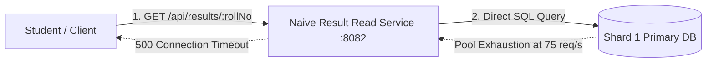

### Request & Technical Execution

1. **Client Request & Controller Entry:** When a student submits their 12-digit roll number (e.g., `160423733001`), the HTTP GET request arrives at `ResultController.java` on port `8082`. The controller validates the format using `@Pattern(regexp = "^\\d{12}$")`.
2. **Profile-Based Implementation Selection:** The controller delegates the call to `resultReadService.findByRollNo(rollNo)`. Because the application runs with the `naive` profile, Spring injects `NaiveResultReadService.java` instead of the optimized implementation.
3. **Shard Resolution & Context Setting:** Inside `NaiveResultReadService.java`, three steps occur:
   - **Prefix Extraction:** Extracts the first four digits (`1604`) using `substring(0, 4)`.
   - **Shard Lookup:** Passes `1604` to `ShardMap`, which reads `contracts/shard-map.yml` and identifies that college `1604` resides in `"shard1"`.
   - **Thread Context Setting:** Sets `"shard1"` into the `ThreadLocal` context via `shardContext.useShard("shard1")`.
4. **Database Query via Spring Data JPA:** Inside a `try-finally` block, the service invokes `resultRepository.findPublishedByRollNo(rollNo)`. Under the hood, Spring's `AbstractRoutingDataSource` inspects the `ThreadLocal` context, pulls a connection from the **Shard 1 Primary database connection pool**, and executes the SQL query.
5. **Context Cleanup & DTO Mapping:**
   - The `finally` block immediately restores the previous shard context to prevent `ThreadLocal` leakage across pooled worker threads.
   - The raw database entities (`ResultEntity`) are transformed into clean DTOs (`ResultResponse`).
6. **Response Delivery:** The controller wraps the DTO list into a standardized `ApiResponse` envelope (`status: "success"`, `statusCode: 200`), serializes it to JSON, and sends it back to the client.

### Architectural Vulnerability & Failure Mode

While simple, this architecture fails severely under result-day traffic:

- **Primary DB Saturation:** Read queries target the write primary database instead of dedicated read replicas.
- **Connection Pool Exhaustion:** With no Redis cache, every request must lease one of only **10 HikariCP connections**. At 75 requests/second, the pool exhausts completely, causing response times to balloon from 20 ms to **6,480 ms**, dropping **19% of requests with 500 connection timeouts**.

<br><br>

---

## Scenario 2: Cache Hit (Warm Cache with Redis)

In the second scenario, we introduce an in-memory caching tier using the **Cache-Aside pattern** powered by Redis (port `6379`). This scenario models result-day behavior where students, parents, and colleges repeatedly query and refresh popular roll numbers.

### Data Flow

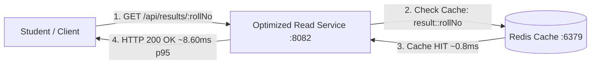

### Request & Technical Execution

1. **Client Request & Controller Interception:** The student submits their roll number (e.g., `160423733001`). The request lands on `ResultController.java` on port `8082`, passes `@Pattern` 12-digit validation, and invokes `resultReadService.findByRollNo(rollNo)`.
2. **Spring AOP Cache Interception:** Because the application runs with `-Profile optimized`, Spring routes the call toward `OptimizedResultReadService.java`. Before the method body executes, Spring's `@Cacheable(cacheNames = "result", key = "#rollNo")` AOP proxy intercepts the call.
3. **Redis In-Memory Lookup (Cache HIT):** The proxy queries Redis for key `result::160423733001`. The cached JSON payload is found in Redis RAM and returned in **~0.8 ms**.
4. **Bypassing Downstream Databases:** Because the data was found:
   - The method body of `OptimizedResultReadService` is **never executed**.
   - `ShardDatabaseReader` is **never called**.
   - **Zero database connections are leased, and zero SQL queries are run.**
5. **Instant Delivery:** The proxy deserializes the JSON into a `List<ResultResponse>`, passes it back to `ResultController`, which wraps it into an `ApiResponse` and sends HTTP 200.
   - **Performance Under Surge:** Under a heavy 300 to 500 req/s load, p95 response time drops from 6,480 ms down to **8.60 ms** (a 99.8% speedup) with **0% errors**.

<br><br>

---

## Scenario 3: Cache Miss (Database Fallback with Bulkhead & Circuit Breaker)

In the third scenario, a student queries an un-cached roll number (checking for the first time). When a cache miss occurs, the architecture must query the database, but it does so through **three defensive shields** to prevent the database from collapsing.

### Data Flow

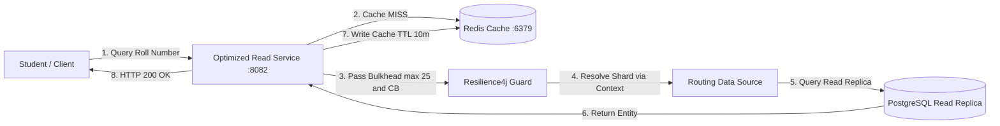

### Request & Technical Execution

1. **Cache Miss Detection:** The request enters `ResultController` and reaches the `@Cacheable` proxy on `OptimizedResultReadService`. Redis returns `null` (Cache Miss).
2. **Fallback Execution in Service Layer:** Because the cache missed, Spring allows the `findByRollNo()` method body to execute:
   - It extracts the college code (`1604`) via `substring(0, 4)`.
   - `shardMap.shardFor("1604")` looks up `contracts/shard-map.yml` and resolves `"shard1"`.
   - A `switch` statement delegates the call to `shardDatabaseReader.readShard1(rollNo)`.
3. **Resilience4j Bulkhead & Circuit Breaker Protection:** Inside `ShardDatabaseReader.java`, two Resilience4j interceptors protect the database:
   - **Per-Shard Bulkhead (`@Bulkhead`):** Caps concurrent database executions to **25 queries maximum**. If hundreds of cache misses arrive simultaneously, the bulkhead queues and caps calls, completely preventing connection pool starvation.
   - **Per-Shard Circuit Breaker (`@CircuitBreaker`):** Isolates Shard 1 from Shard 2. If the Shard 1 database goes down, its circuit trips OPEN within 25 ms, while Shard 2 continues serving students without failure.
4. **Read Replica Query via `AbstractRoutingDataSource`:** `ShardDatabaseReader` sets `"shard1"` into `ShardContext` (`ThreadLocal`). Under the `optimized` profile, `ShardRoutingConfiguration` binds `"shard1"` to dedicated PostgreSQL Read Replicas (`SHARD_1_PRIMARY_REPLICA`), completely shielding the primary write master.
5. **SQL Execution & Automatic Cache Population:**
   - `ResultRepository.findPublishedByRollNo(rollNo)` runs the JPQL query on the read replica and returns `ResultEntity`.
   - It maps the entities to `ResultResponse` DTOs.
   - **Automatic Cache-Aside Write:** As the response exits the `@Cacheable` boundary, Spring automatically writes the result into Redis with a **10-minute TTL**.
   - The next time this roll number is queried, it will instantly become a Scenario 2 cache hit.

<br><br>

---

## Scenario 4: API Gateway Perimeter Defense & Traffic Shaping

In production, students and automated scripts do not query internal microservices directly. We place an **API Gateway** (Port `8081`) as a perimeter defense shielding the **Result Read Service** (Port `8082`). The gateway resolves three major vulnerabilities:

1. Malformed and fraudulent roll numbers consuming backend database CPU.
2. Students repeatedly spamming the refresh button (denial-of-service bursts).
3. Downstream service outages causing client browsers to hang on TCP timeouts.

### Data Flow

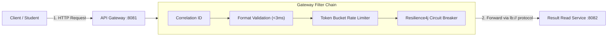

### Filter Hierarchy and Execution Order

Spring Cloud Gateway organizes filters into a **Filter Chain** (`GatewayFilterChain`). Execution order is governed by the `Ordered` interface, where **lower numerical values execute first**:

| Order | Filter | Order Value | Responsibility |
|---|---|---|---|
| **1** | Gateway Correlation ID Filter | `Ordered.HIGHEST_PRECEDENCE` (`-2,147,483,648`) | Generates a unique UUID tracking ID (`X-Correlation-Id`), stamping it on request headers and log lines across all microservices. |
| **2** | Roll Number & College Validation Filter | `Ordered.HIGHEST_PRECEDENCE + 1` (`-2,147,483,647`) | Validates the 12-digit format and verifies college existence against `CollegeCatalog` in memory. Rejects bad traffic in <3 ms (HTTP 400). |
| **3** | Request Rate Limiter Filter | Route Filter Index `[0]` (Order `0`) | Token-bucket rate limiting backed by Redis State (Port 6380). Evaluates client IP address via `clientIpKeyResolver`. |
| **4** | Circuit Breaker Filter | Route Filter Index `[1]` (Order `1`) | Resilience4j circuit breaker wrapping downstream calls. Fast-fails to a fallback controller if the read service degrades. |
| **5** | Netty Routing & Forwarding Filter | `Ordered.LOWEST_PRECEDENCE` (`+2,147,483,647`) | Resolves dynamic instances via Eureka and opens the outbound TCP socket to port `8082`. |

*Architectural Rationale:* Validation (pure CPU) runs before Rate Limiting (which requires a Redis call) so that garbage requests never waste Redis operations. Rate Limiting runs before the Circuit Breaker so that abusive spam never pollutes circuit breaker failure metrics.

### How Each Filter Defends the Perimeter

1. **Correlation ID Tracking (`GatewayCorrelationIdGlobalFilter`):** Every incoming HTTP request receives an `X-Correlation-Id`. If a request encounters an error anywhere in the distributed pipeline, this ID allows engineers to trace logs across the gateway, read service, and database layers instantly.
2. **Edge Format Validation (`RollNumberValidationGlobalFilter`):** Validates `rollNo` using `@Pattern(regexp = "^\\d{12}$")` and checks the 4-digit college code against `shard-map.yml`. Invalid inputs (e.g., 11 digits, alphanumeric strings, unknown colleges) are terminated at the gateway in under **3 ms** with **HTTP 400 Bad Request**, shielding backend CPU, Redis, and PostgreSQL entirely.
3. **Distributed Token-Bucket Rate Limiting (`RequestRateLimiter`):** Tracks requests per client IP in Redis State (port 6380) using `clientIpKeyResolver`. Configured with:
   - `burstCapacity = 30`: Allows an instantaneous burst of up to 30 requests.
   - `replenishRate = 10`: Refills tokens at a steady-state rate of 10 requests per second. Abusive clients exceeding their quota receive **HTTP 429 Too Many Requests**, preventing single users or bots from starving portal resources.
4. **Resilience4j Circuit Breaker (`readService`):** Monitors outbound calls to the read service. If the failure rate reaches **50% across a minimum of 10 calls**, or calls exceed a **10-second timeout**, the breaker trips OPEN:
   - **Fallback Execution:** Requests are redirected to `ReadServiceFallbackController` (`/fallback/read`), which returns **HTTP 503 Service Unavailable** with a `Retry-After: 5` header, preventing browser freezes.
   - **Self-Healing Recovery:** After a 10-second cooldown, the breaker enters HALF-OPEN and admits 3 real probe requests. If all 3 succeed, it transitions back to **CLOSED (Normal)**.
5. **Netty Service Discovery Forwarding (`NettyRoutingFilter`):** The route defines `uri=lb://result-read-service`. The `lb://` prefix instructs Spring Cloud Gateway to query the **Eureka Service Registry** (Port 8761) for active instances of `RESULT-READ-SERVICE`. Eureka returns `http://localhost:8082`, and Netty forwards the HTTP packet across the local network.

<br><br>

---

## Scenario 5: Horizontal Scaling & Dynamic Load Balancing

In the fifth read scenario, all protections from Scenario 4 remain active. We introduce **Horizontal Scaling** paired with **Spring Cloud LoadBalancer** to solve the final scalability bottleneck: handling traffic surges beyond the CPU and thread capacity of a single server. Rather than scaling vertically, we spin up multiple instances of `result-read-service` and distribute incoming traffic across them.

### Data Flow

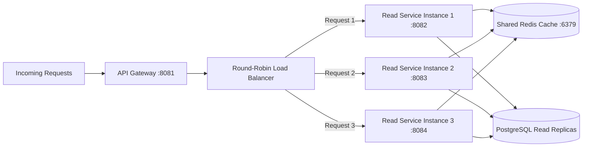

### 1. Three Concurrent Instances

Instead of a single read instance on port `8082`, our orchestration script (`scripts/start-stack.ps1`) boots three independent instances of the same Spring Boot JAR:

- **Instance 1:** Listening on Port `8082` (`SERVER_PORT=8082`)
- **Instance 2:** Listening on Port `8083` (`SERVER_PORT=8083`)
- **Instance 3:** Listening on Port `8084` (`SERVER_PORT=8084`)

*Configuration Detail:* Ports are not hardcoded in Java. `application.properties` specifies `server.port=${SERVER_PORT:8082}`, allowing dynamic port assignment at launch.
All three instances share the same centralized Redis Cache (Port 6379) and query the same PostgreSQL Read Replicas. If Instance 1 populates Redis during a cache miss, Instances 2 and 3 immediately benefit from that cached data on subsequent requests.

### 2. Dynamic Service Registration with Eureka

Each instance includes `spring-cloud-starter-netflix-eureka-client`. Upon startup, each instance contacts the Eureka Service Registry (Port 8761) and registers itself under the unified service identifier: `spring.application.name=result-read-service`.
Eureka maintains a live, in-memory table of available nodes:

```text
Service ID: RESULT-READ-SERVICE
Available Instances:
  ├── http://localhost:8082
  ├── http://localhost:8083
  └── http://localhost:8084
```

Every 2 seconds, the API Gateway polls Eureka (`eureka.client.fetch-registry=true`) to keep its local routing table synchronized. If an instance crashes or a new one spins up, the gateway updates its pool automatically without manual intervention.

### 3. Spring Cloud LoadBalancer & The `lb://` Protocol

In the Gateway's route definition (`api-gateway/src/main/resources/application.properties`), the destination URI is declared as:

```properties
spring.cloud.gateway.server.webflux.routes[0].uri=lb://result-read-service
```

The `lb://` prefix is the architectural switch:
- An `http://` prefix tells the gateway to forward to a static address.
- The `lb://` prefix activates Spring Cloud LoadBalancer (`spring-cloud-starter-loadbalancer`), instructing Netty to distribute requests across the instance list retrieved from Eureka.

By default, Spring Cloud LoadBalancer uses `RoundRobinLoadBalancer`, which maintains an atomic counter (`counter++ % instances.size()`) to cycle through available nodes evenly.

### 4. Round-Robin Real-Time Traffic Distribution

When concurrent student requests arrive at Port `8081`, the gateway's load balancer distributes them sequentially:

| Incoming Request | Target Instance | Destination Port | Load Balancer Index |
|---|---|---|---|
| Request 1 | Instance 1 | `8082` | `0` |
| Request 2 | Instance 2 | `8083` | `1` |
| Request 3 | Instance 3 | `8084` | `2` |
| Request 4 | Instance 1 | `8082` | `0` (Reset) |
| Request 5 | Instance 2 | `8083` | `1` |

**Instrumentation & Verification:** To verify that requests are distributed across instances, each read service includes `InstanceIdResponseHeaderFilter.java`, which stamps the response with: `X-Instance-Id: result-read-service:8083`.
Our k6 scaling suite (`tests/read/run-scaling.ps1`) reads this header to confirm an even ~33%/33%/33% traffic split.

### 5. End-to-End Request Journey

1. **Client Submission:** Student sends `GET http://localhost:8081/api/results/160423737001`.
2. **Perimeter Defense:** Gateway validates the 12-digit format (<3 ms), checks token-bucket limits in Redis State (Port 6380), and verifies circuit breaker health.
3. **Dynamic Resolution:** Gateway detects `lb://result-read-service`, inspects its Eureka cache, and uses `RoundRobinLoadBalancer` to select the next port (e.g., `8083`).
4. **Network Dispatch:** Gateway's `NettyRoutingFilter` forwards the HTTP request to `http://localhost:8083/api/results/160423737001`.
5. **Read Service Processing:** Instance 2 checks the shared Redis cache (Port 6379). On a hit, it returns in ~1 ms; on a miss, it routes to PostgreSQL Read Replica 1 protected by its 25-query bulkhead.
6. **Response Delivery:** The response flows back through the Gateway to the student browser with status `200 OK` and `X-Instance-Id: result-read-service:8083`.

<br><br>

---

## Final Architectural Conclusion: The 5-Stage Evolution

The read tier transformed from an initial prototype into a production distributed architecture through five incremental phases:

1. **Scenario 1 (Naive Baseline):** Proved that direct relational database queries collapse under just 75 req/s due to HikariCP connection starvation (6,480 ms latency, 19% dropped requests).
2. **Scenario 2 (Warm Cache):** Introduced Redis Cache-Aside, serving repeated student lookups in ~8.60 ms and sustaining 500 req/s with 0% dropped requests.
3. **Scenario 3 (Protected Cache Miss):** Added Resilience4j bulkheads (capping concurrent DB queries at 25), per-shard circuit breakers, and dedicated PostgreSQL read replicas to prevent database collapse on cache misses.
4. **Scenario 4 (Perimeter Defense):** Added an API Gateway to reject malformed roll numbers in memory (<3 ms), rate-limit abusers (token bucket), and catch backend outages with graceful HTTP 503 fallbacks.
5. **Scenario 5 (Horizontal Scale-Out):** Integrated Eureka Service Discovery and Spring Cloud LoadBalancer to distribute traffic across multiple instances dynamically via Round-Robin, eliminating single-server CPU ceilings.

---

### Read Path Summary Table

| Scenario | Cache Tier | Database Target | Concurrency Guard | Failure Mode / Throughput |
|---|---|---|---|---|
| **1. Naive Baseline** | None | Primary DB | None (10 Hikari connections) | Fails at 75 req/s (6,480 ms latency, 19% errors). |
| **2. Warm Cache Hit** | Redis (~0.8 ms) | Bypassed (0 queries) | Spring Cache AOP | Sustains 500 req/s at 8.60 ms p95 with 0% errors. |
| **3. Protected Cache Miss** | Redis (Cache-Aside) | Dedicated Read Replicas | 25-query Bulkhead + Circuit Breaker | Safe fallback without connection pool starvation. |
| **4. Gateway Perimeter** | Redis State (Tokens) | Read Service via Netty | Edge Token Bucket + Circuit Breaker | Filters invalid inputs (<3 ms) and handles outages with HTTP 503. |
| **5. Horizontal Scaling** | Shared Redis | Read Replicas | Round-Robin Load Balancer | Distributes load evenly across 3 dynamic instances via Eureka. |

<br><br><br>

---

# Workflow 2: Result Upload Pipeline (Write Path)

The Write Service is divided into two main workflows: **Upload** and **Publish**. During the upload phase, an administrator uploads a CSV file containing student results, which is validated, partitioned, and stored in the database as unreleased drafts. During the publish phase, those results are officially released to students across all database shards.

The upload phase covers three scenarios:
1. **Scenario 1:** The complete end-to-end upload workflow, from file upload to sharded database persistence.
2. **Scenario 2:** How the system guarantees durability during worker or message broker crashes.
3. **Scenario 3:** How the Dead-Letter Queue (DLQ) quarantines poison pills to prevent infinite retry loops.

## Scenario 1: End-to-End File Upload and Sharded Persistence

The upload workflow spans three core services: the **API Gateway**, the **Result Ingestion Service**, and the **Result Persistence Service**, with **RabbitMQ** acting as the message broker between the ingestion and database tiers.

### Data Flow

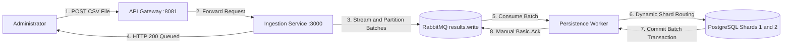

### Technical Execution

#### Step 1: API Gateway (Edge Perimeter)
When an administrator submits an upload request, it first hits the API Gateway (`port 8081`) rather than communicating directly with backend services. The Gateway performs three essential edge operations:
- **Admin Authentication:** Verifies the `X-Admin-Api-Key` header, immediately rejecting unauthorized clients.
- **Network Admission Control:** Rejects requests with payloads exceeding 50 MB at the network perimeter before they consume internal server resources.
- **Reverse Proxy Routing:** Forwards authenticated, valid multipart upload requests to the internal Result Ingestion Service (`port 3000`).

#### Step 2: Result Ingestion Service (Streaming & Partitioning)
Inside the **Result Ingestion Service** (Node.js/Express in `result-ingestion-service`), the service receives the multipart file and processes it with zero memory bloat:
- **Second-Layer Size Protection:** Multer middleware enforces the 50 MB boundary on incoming byte streams.
- **Streaming Validation:** Instead of buffering the entire CSV into massive JSON arrays in memory, the service pipes the file stream through a CSV parser. A Zod schema validates each row line-by-line, verifying required fields (`roll_no`, `college_code`, `sgpa`, subjects JSON) and aborting early if format is corrupted.
- **College-Coded Batching:** Rather than splitting data blindly, the parser groups rows by **college code** (e.g., College `1604` vs. College `1608`). It then slices each college group into chunks of **500 rows**. Partitioning by college is critical because college codes determine which physical database shard the records belong to.

#### Step 3: Asynchronous Message Processing (RabbitMQ)
Instead of forcing the admin to wait for thousands of database insertions to execute synchronously, the Ingestion Service offloads the work to RabbitMQ:
- **Immediate Non-Blocking Response:** Each 500-row batch is wrapped into a JSON message stamped with a unique `batchId` and timestamp. The service publishes these batches to the `results.direct` exchange using routing key `results.write`.
- Once all batches are accepted by RabbitMQ, the Ingestion Service immediately returns **HTTP 200 OK** (`"Results uploaded and queued successfully"`) with summary metadata. The admin receives confirmation in seconds, completely freed from waiting on downstream database writes.
- **Durable Buffering:** RabbitMQ acts as a traffic buffer, holding the batches safely on disk in the `results.write` queue until the persistence worker is ready to consume them.

#### Step 4: Result Persistence Service (Sharded Batch Persistence)
The **Result Persistence Service** (Spring Boot worker in `result-persistence-service`) operates independently in the background:
- **AMQP Message Consumption:** A `@RabbitListener(queues = "results.write")` method in `ResultBatchConsumer.java` pulls batches from the `results.write` queue.
- **Dynamic Shard Routing:** The service inspects the batch's `collegeCode` against `shard-map.yml` (e.g., College `1604` maps to Shard 1; College `1608` maps to Shard 2) and selects the corresponding JDBC DataSource.
- **Atomic Batch Execution:** The batch is executed inside a programmatic Spring `TransactionTemplate` for that specific shard, guaranteeing that all 500 rows commit together or roll back completely on failure.
- **Idempotent Upsert (`ON CONFLICT`):** The persistence worker executes a raw SQL batch query using PostgreSQL's `INSERT ... ON CONFLICT (exam_id, roll_no, semester) DO UPDATE`. If a student record is new, it is inserted; if it already exists from a prior upload, its grades are updated in-place.
- **Draft Isolation:** All results are inserted with `published = false`. The examination is stored in a `DRAFT` status, ensuring students cannot see the results on the portal until the separate Publish Saga is executed.
- **Message Acknowledgment:** Only after PostgreSQL successfully commits the transaction does the worker send an acknowledgment (ACK) back to RabbitMQ, permanently removing the batch from the queue.

#### Why We Use Raw JDBC Instead of JPA Here (CQRS Rationale)

You will notice an architectural split between our services:
- In the **Read Service**, we use **Spring Data JPA** because we query individual student records and map them to clean domain objects.
- In the **Persistence Service**, we avoid JPA and use raw **Spring JdbcTemplate**.

When saving 10,000+ student rows in batches of 500, JPA creates severe memory overhead. Hibernate tracks every single entity in memory for dirty-checking, which slows down ingestion and risks running out of memory. 

With `JdbcTemplate`, we bypass Hibernate completely and run high-speed batch inserts directly against PostgreSQL using native `INSERT ... ON CONFLICT DO UPDATE` upsert statements.

This separation—using JPA for the query model and raw JDBC for high-volume write commands—is an application of **CQRS (Command Query Responsibility Segregation)**.

<br><br>

---

## Scenario 2: Failure Handling and Fault Tolerance

In this scenario, we examine what happens when individual services, network connections, or message brokers crash during the upload workflow, and how the architecture guarantees zero data corruption or message loss.

### Data Flow

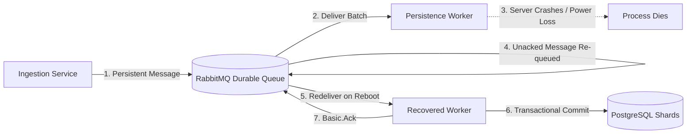

### Technical Execution & Failure Modes

#### Step 1: Ingestion Service Failure (Edge Fail-Fast)
If the Result Ingestion Service is unavailable or crashes:
- The API Gateway cannot reach port `3000` and immediately responds to the administrator with an **HTTP 502 Bad Gateway** or **503 Service Unavailable**.
- **Guaranteed State:** The request fails fast at the perimeter. Zero corrupt files enter the system, no orphan records reach the databases, and the admin is immediately alerted to retry.

#### Step 2: RabbitMQ Durability (Surviving Broker Crashes)
What happens if the RabbitMQ broker itself loses power or the container restarts while thousands of student records are sitting in the queue? To guarantee messages survive a broker restart, durability is enforced at two distinct levels:
1. **Durable Queue Structure (`durable: true`):** Configured in `definitions.json`, this instructs RabbitMQ to persist queue metadata to disk so the queue is automatically recreated upon reboot.
2. **Persistent Message Payloads (`delivery_mode: 2`):** When the Ingestion Service publishes to `results.direct`, it sets `persistent: true`. This forces RabbitMQ to write the message payload to its write-ahead log (WAL) on disk before confirming receipt.

Even if Docker or the host machine abruptly restarts under heavy load, RabbitMQ reloads the pending batches from disk upon boot. Queued messages remain completely intact.

#### Step 3: Persistence Service Failure (Worker Crash & Transaction Rollback)
Now, suppose the Result Persistence Service pulls Batch 3 from RabbitMQ, starts inserting records, but crashes halfway through (e.g., at row 250 out of 500) due to an out-of-memory error or server reboot. The system prevents data corruption through two synchronized mechanisms:

1. **Database Transaction Rollback:** Database updates are wrapped inside a Spring `TransactionTemplate`. Because the worker crashed before reaching the commit step, PostgreSQL automatically discards the 250 half-written rows. The database remains clean—no half-committed batches or orphaned student records exist. *(Note: Batches 1 and 2 are unaffected because their transactions were already successfully committed).*
2. **Automatic AMQP Re-Queueing:** The persistence worker operates on an acknowledgment-based model: it confirms a message to RabbitMQ **only after** PostgreSQL commits the transaction. While the worker is processing Batch 3, RabbitMQ marks the message as **Unacknowledged**, keeping the original copy safe on disk.
   When the worker crashes, its TCP socket connection to RabbitMQ abruptly closes. RabbitMQ immediately detects connection loss, recognizes that Batch 3 was never acknowledged, and flips its status from **Unacknowledged** back to **Ready**.

When the persistence service boots back up, RabbitMQ redelivers Batch 3. The worker retries the batch from row 1, commits all 500 rows cleanly via idempotent upserts (`ON CONFLICT DO UPDATE`), and finally sends the acknowledgment.

#### Step 4: The Poison Pill & The Infinite Retry Problem
While automatic re-delivery guarantees that temporary crashes don't lose data, it introduces a dangerous new failure mode: **what happens if a batch fails not because of a hardware crash, but because the data itself is invalid?**

Suppose a batch contains a "poison pill"—for example, row 250 violates a database foreign key constraint or contains invalid data that the parser missed:
1. The persistence worker attempts to process the batch → the database throws an exception → the transaction rolls back.
2. Because the batch was not acknowledged, RabbitMQ marks it as `Ready` and immediately redelivers it.
3. The persistence worker picks it up again, hits the same invalid row, throws the same error, and rolls back again.

Without an intervention mechanism, this batch will cycle between RabbitMQ and the worker indefinitely—consuming CPU, flooding error logs, and permanently blocking subsequent healthy batches from being processed.

<br><br>

---

## Scenario 3: Dead-Letter Queue (DLQ) — Poison Pill Defense

To handle poison pills without crashing workers or freezing the queue, we configure a dedicated **Dead-Letter Exchange** (`results.dlx`) and **Dead-Letter Queue** (`results.write.dlq`) in RabbitMQ.

### Data Flow

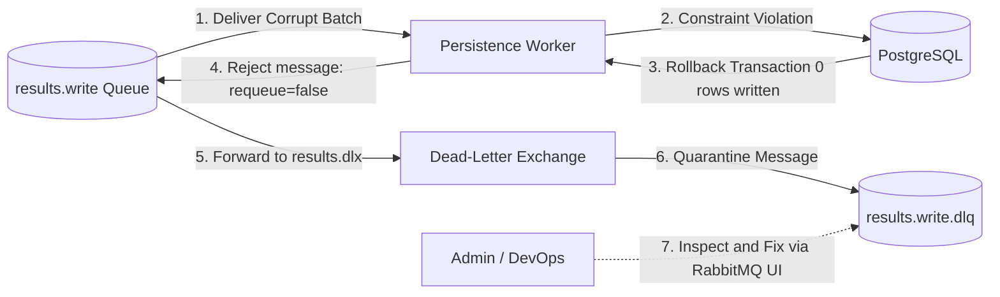

### Technical Execution

#### Step 1: The Dead-Letter Trigger Mechanism
1. When the `results.write` queue is initialized via `definitions.json`, it is configured with dead-letter forwarding arguments:
   ```json
   "x-dead-letter-exchange": "results.dlx",
   "x-dead-letter-routing-key": "results.write.dlq"
   ```
2. When the Result Persistence Service attempts to save Batch 3 and encounters a database constraint violation on row 250:
   - The Spring `TransactionTemplate` rolls back the in-flight transaction (0 rows written to Postgres).
   - Rather than silently swallowing the error, the worker rejects the message with `requeue = false` (a `basic.nack` rejection).
3. RabbitMQ detects the rejection, pulls Batch 3 out of the active queue, and routes it through `results.dlx` into `results.write.dlq`.

#### Step 2: Fault Isolation (Independent Batch Processing)
The primary architectural advantage of this design is **fault isolation**:
- If an administrator uploads a CSV with 10,000 student results (split into 20 batches of 500 rows), and Batch 3 contains a corrupt record:
  - Batch 3 is quarantined into `results.write.dlq`.
  - **The remaining 19 batches (9,500 students) continue processing normally without interruption.**
- One malformed record in a single college chunk does not stop the entire university portal from ingesting valid results.

#### Step 3: Observability, Diagnostics, and Replay
When RabbitMQ dead-letters a message, it attaches metadata headers (including `x-death` headers) detailing:
- The exact timestamp of the rejection.
- The original queue name (`results.write`).
- The number of times the message failed.

Administrators and operators can open the RabbitMQ Management Dashboard (on port `15672`), inspect the quarantined batch JSON, identify the exact row or typo causing the database constraint error, and fix the root issue. Once the data issue is resolved, the batch can be safely re-published directly into the active queue without needing to re-upload the entire CSV file.

---

### Upload Path Summary Table

| Scenario | Core Problem | Architectural Solution |
|---|---|---|
| **Scenario 1: Happy Path** | Synchronous upload bottlenecks & memory bloat | Fast-CSV streaming, college partitioning, asynchronous RabbitMQ queuing, and idempotent JDBC batch upserts (`published = false`). |
| **Scenario 2: Crash Resilience** | Server reboot or power failure mid-upload | Queue durability (`durable: true`), message disk persistence (`persistent: true`), and database transactional rollbacks. |
| **Scenario 3: Poison Pill Defense** | Corrupt data causing infinite worker retry loops | Spring AMQP rejection (`requeue = false`), Dead-Letter routing (`results.dlx`), and quarantine isolation in `results.write.dlq`. |

<br><br><br>

---

# Workflow 3: Result Publishing Saga (Release Path)

An administrator wants to publish examination `EXAM_1`. Currently:
- Shard 1 (College 1604) has 5,000 students saved with `published = false`.
- Shard 2 (College 1608) has 5,000 students saved with `published = false`.
- The exam is in `DRAFT` status. No student can see their results.

The goal is to safely flip all 10,000 students to `published = true` across both databases, announce it to Kafka, and pre-warm Redis—with zero distributed locking (no two-phase commit).

## Scenario 1: Multi-Shard Publication & Cache Warming (Happy Path)

This scenario represents the complete, error-free release sequence.

### Data Flow

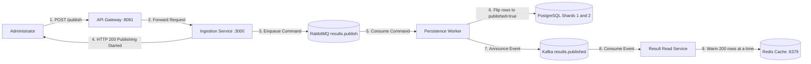

### Technical Execution

#### Step 1: Admin Triggers the Publish
The administrator makes an authenticated request:
```bash
curl -X POST http://localhost:8081/admin/exams/EXAM_1/publish \
  -H "X-Admin-Api-Key: secret123"
```
The **API Gateway** checks `X-Admin-Api-Key`, verifies validity, and forwards the request to the Ingestion Service on port `3000`.

#### Step 2: Ingestion Service Hands Off to RabbitMQ
Inside `IngestionController.ts` and `IngestionService.ts`, the Ingestion Service does not touch the databases. It simply builds a command:
```typescript
const message = {
  examId: "EXAM_1",
  requestedAt: new Date().toISOString()
};
await this.rabbitMqClient.publishCommand("results.publish", message);
```
It responds to the administrator immediately:
```json
{ 
  "status": "success", 
  "message": "Publication procedure initiated for examination EXAM_1", 
  "data": { "status": "PUBLISHING" } 
}
```
The administrator receives instant confirmation that publication has started. Everything else proceeds asynchronously.

#### Step 3: RabbitMQ Buffers the Command
The command is held safely on disk in the `results.publish` queue until the Java persistence worker picks it up.

#### Step 4: The Persistence Saga Executes
In `PublishCommandConsumer.java`, the `@RabbitListener` method receives the message and calls `ExamPublishService.executePublish("EXAM_1")`.

Inside `ExamPublishService.java`, the coordinated saga state machine executes:

1. **Mark Status PUBLISHING:**
   ```java
   shard1Jdbc.update("UPDATE exams SET publish_status = 'PUBLISHING' WHERE exam_id = ?", examId);
   shard2Jdbc.update("UPDATE exams SET publish_status = 'PUBLISHING' WHERE exam_id = ?", examId);
   ```
   Anyone querying the exam status endpoint sees that publication is in progress.

2. **Flip Rows on Shard 1:**
   ```java
   int flipped1 = shard1Tx.execute(status ->
       shard1Jdbc.update("UPDATE results SET published = true WHERE exam_id = ? AND published = false", examId)
   );
   ```
   PostgreSQL Shard 1 flips all 5,000 students to `published = true`.

3. **Flip Rows on Shard 2:**
   ```java
   int flipped2 = shard2Tx.execute(status ->
       shard2Jdbc.update("UPDATE results SET published = true WHERE exam_id = ? AND published = false", examId)
   );
   ```
   PostgreSQL Shard 2 flips all 5,000 students to `published = true`.

4. **Point of No Return Milestone:** Both shards have flipped successfully. The service marks both databases as `SHARDS_PUBLISHED`:
   ```java
   shard1Jdbc.update("UPDATE exams SET publish_status = 'SHARDS_PUBLISHED' WHERE exam_id = ?", examId);
   shard2Jdbc.update("UPDATE exams SET publish_status = 'SHARDS_PUBLISHED' WHERE exam_id = ?", examId);
   ```
   > **What does "Point of No Return" mean?** At this exact milestone, results are legally live in both databases. **Rollback is now strictly forbidden.** No matter what failures occur next, the system will never roll back to draft—it will only heal forward.

#### Step 5: Announce to Kafka & Mark Final `PUBLISHED`
Inside `ExamPublishService.java`, the persistence worker posts the announcement to **Apache Kafka**:
```java
PublishedEvent event = new PublishedEvent("evt-uuid", "results.published", "EXAM_1", Instant.now());

// Send to Kafka topic "results.published" and wait for broker confirmation:
kafkaTemplate.send("results.published", examId, event).get(10, TimeUnit.SECONDS);
```
Once Kafka confirms receipt, it marks both shards with the final status `PUBLISHED`:
```java
shard1Jdbc.update("UPDATE exams SET publish_status = 'PUBLISHED' WHERE exam_id = ?", examId);
shard2Jdbc.update("UPDATE exams SET publish_status = 'PUBLISHED' WHERE exam_id = ?", examId);
```
Finally, Java sends a manual **ACK** to RabbitMQ to delete the original `results.publish` command.

#### Step 6: Cache Pre-Warming into Redis
Now the Read Service consumes the announcement:
- Inside `PublishEventConsumer.java`, the `@KafkaListener` catches the event:
  ```java
  @KafkaListener(topics = "results.published", groupId = "read-service-cache-warmup")
  public void onExamPublished(PublishedEvent event) {
      cacheWarmupService.warmupExam(event.examId());
  }
  ```
- Inside `CacheWarmupService.java`:
  1. It loops through `shard1` and `shard2`.
  2. It reads students in pages of **200 at a time** from the primary database:
     ```java
     List<ResultEntity> rows = shardDatabaseReader.fetchExamPageFromPrimary(shard, examId, page, 200);
     ```
  3. It writes each student into Redis with key `result::<rollNo>`:
     ```java
     cacheWarmupWriter.putInCache(student.rollNo(), student);
     ```
  4. It pauses for 100 ms between pages (`Thread.sleep(100)`) so the primary database connection pool is not overloaded.
  5. It continues page by page until every student record is pre-warmed in Redis.

### The Final State

| Component | Status |
|---|---|
| **Shard 1 (PostgreSQL)** | All rows `published = true`, Exam status: `PUBLISHED`. |
| **Shard 2 (PostgreSQL)** | All rows `published = true`, Exam status: `PUBLISHED`. |
| **Kafka Topic** | `results.published` event logged on the stream. |
| **Redis Cache** | Pre-warmed with all student results. |
| **Student UI** | When students search their roll numbers, **Redis serves results in ~5 ms** with zero database load. |

<br><br>

---

## Scenario 2: Failure Before Point of No Return (Compensating Rollback)

This scenario covers what happens if a failure strikes while flipping shards before the point of no return is reached.

### The Situation
An administrator triggers the publish for `EXAM_1`:
1. The worker sets status to `PUBLISHING`.
2. The worker flips Shard 1 (College 1604) → 5,000 rows flipped to `published = true`.
3. The worker attempts to flip Shard 2 (College 1608) → **FAILURE!** (Network times out, or database connection is dropped).

If the system stops here, a data inconsistency disaster occurs: College 1604 students can see their marks, while College 1608 students see an error. The exam is half-published.

### Data Flow

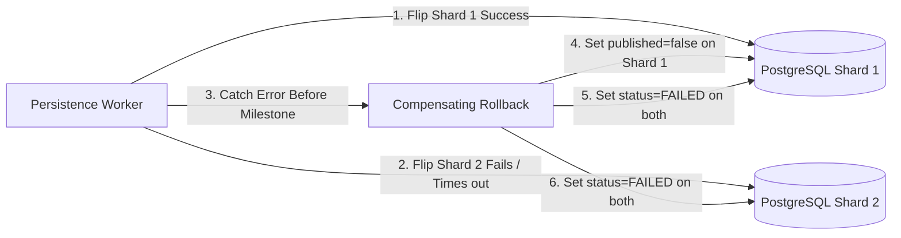

### The Solution: Compensating Transaction
Because the status has **NOT** reached `SHARDS_PUBLISHED` yet, the saga knows it is still safe to undo the work.

Inside `ExamPublishService.java`, the catch block runs compensating rollback logic:
```java
} catch (Exception ex) {
    log.error("Publication failed before point of no return. Undoing flips...");
    rollbackPublish(examId);
    throw ex;
}
```

Inside `rollbackPublish()`, the worker runs compensating SQL queries:
```sql
-- 1. Flip Shard 1 back to unreleased:
UPDATE results SET published = false WHERE exam_id = 'EXAM_1';

-- 2. Mark exam status as FAILED on both databases:
UPDATE exams SET publish_status = 'FAILED' WHERE exam_id = 'EXAM_1';
```

### Architectural Guarantee
- **0 student results are visible.**
- The partial publication on Shard 1 is completely wiped out.
- The exam is marked `FAILED` so administrators can resolve the database issue and retry safely.

<br><br>

---

## Scenario 3: Failure After Point of No Return (Forward Recovery & DLQ)

This scenario covers what happens if a failure strikes after both shards are already flipped and marked `SHARDS_PUBLISHED`.

### The Situation
1. Shard 1 flips to `published = true` → Success.
2. Shard 2 flips to `published = true` → Success.
3. The worker marks both databases as `SHARDS_PUBLISHED` (The Point of No Return is permanently crossed).
4. An unexpected failure strikes immediately after:
   - **Case A:** The server abruptly loses power or crashes.
   - **Case B:** The Kafka broker is completely down or unreachable.

### Data Flow

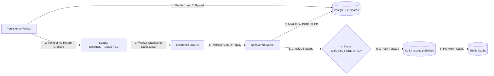

### Why We Never Roll Back Once Live
Because results are already committed and queryable in both databases, rolling back would cause live student grades to suddenly disappear from their screens. In distributed systems, **once data is live, you never roll back—you heal forward.**

### How the System Recovers

#### Case A: If the Server Crashed
1. The server reboots and reconnects to RabbitMQ.
2. Because the Java worker crashed before acknowledging the message, RabbitMQ redelivers the publish command.
3. The Java worker wakes up and inspects the database status:
   ```java
   if (isPastPointOfNoReturn(shard1Status, shard2Status)) {
       log.info("Exam is past point of no return. Resuming completion without rollback.");
       completePublication(examId);
       return;
   }
   ```
4. The worker sees `SHARDS_PUBLISHED` and refuses to roll back.
5. It resumes forward: emits the Kafka event, sets status to `PUBLISHED`, and sends the ACK to RabbitMQ.

#### Case B: If Kafka is Down
1. The persistence worker tries to send the event to Kafka, but Kafka is unreachable.
2. The worker retries. When retries run out:
   - **It does NOT roll back the database.** The exam stays safely in `SHARDS_PUBLISHED`.
   - RabbitMQ moves the publish command into `results.publish.dlq` (The Dead-Letter Queue).
3. Once the Kafka cluster is restored:
   - An administrator replays the message from `results.publish.dlq`.
   - The worker picks it up, emits the Kafka event, pre-warms the cache, and finishes the exam to `PUBLISHED`.

---

## Complete Summary of All 3 Publishing Scenarios

| Scenario | Milestone Reached? | Failure Behavior | Architectural Guarantee |
|---|---|---|---|
| **Scenario 1: Happy Path** | Yes (`SHARDS_PUBLISHED` → `PUBLISHED`) | No failure. Shards flipped, Kafka notified, Redis cache pre-warmed. | Atomic multi-shard publish and sub-10 ms cached student reads. |
| **Scenario 2: Failure Before Point of No Return** | **No** (Shard 2 failed before milestone) | Compensating transaction runs: flips Shard 1 back to `published = false`, marks exam `FAILED`. | Zero partial results leak. Consistent failure state. |
| **Scenario 3: Failure After Point of No Return** | Yes (Both shards were flipped) | Rollback is forbidden. System resumes forward; if Kafka is down, command parks in `results.publish.dlq`. | Live grades never vanish; system always heals forward. |