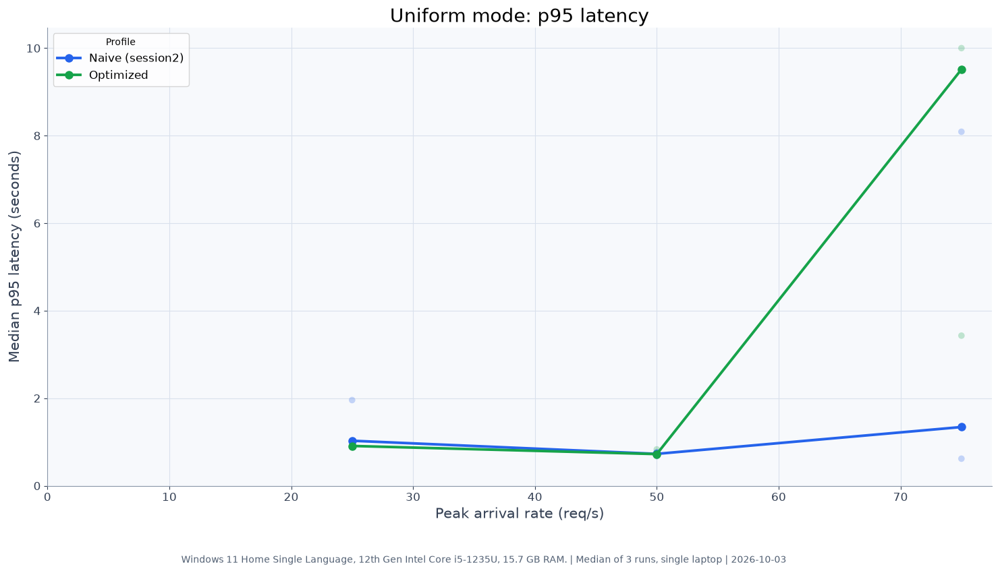
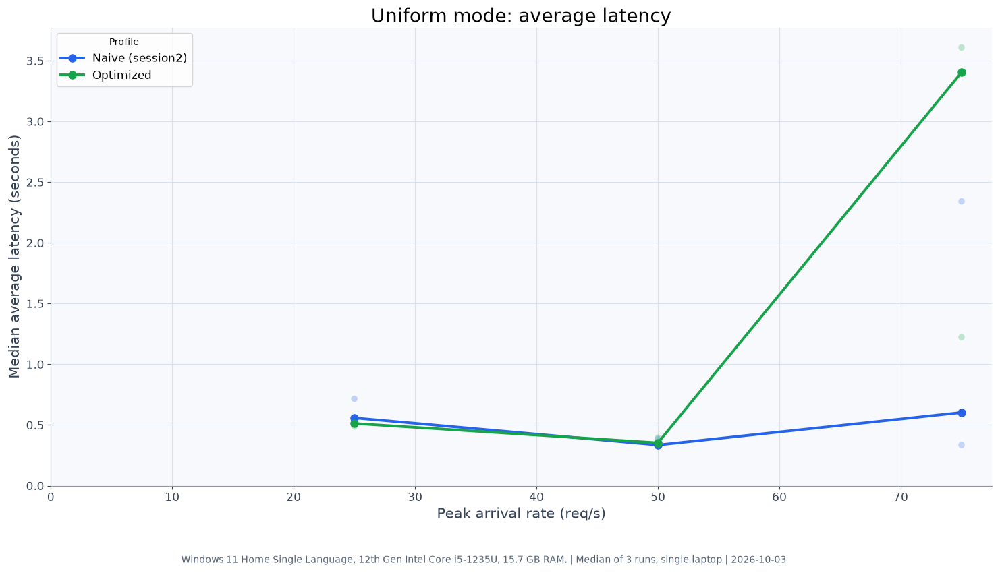
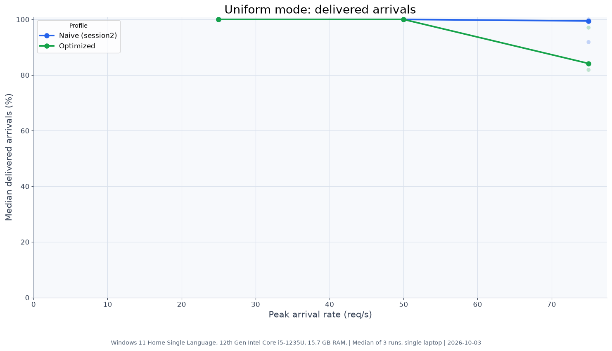
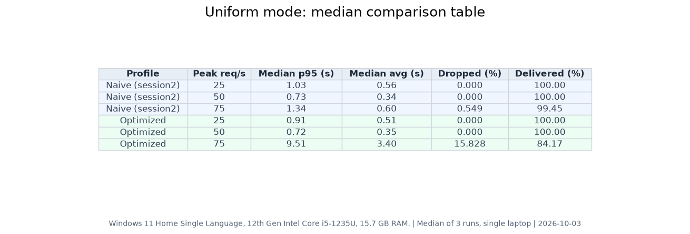

# Results

This comparison uses the `session2` naive runs and the `optimized` runs. Latency and dropped-arrival figures below are copied from the individual profile summaries; the charts show medians and individual-run points.

## Hot mode

Hot mode repeats lookups from a fixed key set, so the cache warms across the series.

| Peak | Naive p95 / avg / dropped | Optimized p95 / avg / dropped |
|---:|---:|---:|
| 50 req/s | 1.02 s / 0.47 s / 0.459% | 0.85 s / 0.15 s / 0.000% |
| 75 req/s | 6.48 s / 3.19 s / 19.056% | 0.76 s / 0.09 s / 0.000% |

> **Note:** the optimized numbers above come from the earlier hand-written cache implementation which included a per-key Redis lock. The current implementation uses Spring `@Cacheable` with the lock removed. See [optimized-v3 results](#optimized-v3-results) below for the current implementation's numbers.


The naive 75 req/s hot result reproduced across sessions: the baseline summary reports 6.38 s p95 and 19.708% dropped, and session2 reports 6.48 s p95 and 19.056% dropped.

Hot mode assumes lookups repeat: students refresh and check friends' results. The 3,000-key hot set is an assumption, not measured OU data. The 75 req/s runs came after six earlier hot runs, so the cache was already warm; a single cold run would see fewer hits. The hot-mode cache hit ratio was not measured. At 25 and 50 req/s, p95 is similar for both profiles (the slowest requests are most likely cache misses that still reach the database); the improvement shows in average latency and at 75 req/s.

## Uniform mode

Uniform mode makes each lookup use a new key, so the cache provides no consistent improvement. The measured cache counters for the uniform runs were 795 hits, 232 negative hits, 15,881 misses, and 20 lock waits. At 50 req/s the session2 p95 was 0.73 s naive versus 0.72 s optimized, while average latency was 0.34 s versus 0.35 s. At 75 req/s, the naive session2 summary reports 1.34 s p95, 0.60 s average, and 0.549% dropped; optimized reports 9.51 s p95, 3.40 s average, and 15.828% dropped. Individual 75 req/s p95 values varied widely: 1.34, 0.62, and 8.09 s naive; 10.00, 3.43, and 9.51 s optimized.






At 75 req/s the optimized profile was not better than naive and may be worse, though the runs overlap (p95 across runs: naive 0.62–8.09 s, optimized 3.43–10.00 s). The cause was not isolated; candidates are extra Redis round trips on misses, replica read capacity, and run-to-run noise.

**Test conditions:** same Windows 11 laptop (12th Gen Intel Core i5-1235U, 15.7 GB RAM), Temurin OpenJDK 25.0.4.1 with `-Xms128m -Xmx512m`, k6 v2.2.0, and the same Neon shard databases; 10 s timeout; runs interleaved the same night.

## How to regenerate

From the repository root, run:

```powershell
.\.venv\Scripts\python.exe .\load-tests\report\make_comparison.py
```

---

## optimized-v3 results

These numbers are from the current `@Cacheable` implementation (per-key Redis lock removed). All runs through the API gateway with `-LoadTest` flag (rate limit 1000 req/s, burst 2000).

| Peak | Mode | Median p95 | Median avg | Delivered | Dropped |
|---:|---:|---:|---:|---:|---:|
| 50 req/s | hot | 0.77 s | 0.21 s | 100.00% | 0.000% |
| 75 req/s | hot | 0.01 s | 0.03 s | 100.00% | 0.000% |

At 75 req/s the cache is fully warm and requests serve from Redis in sub-20 ms. At 50 req/s ramp-up requests still reach the database, producing p95 around 770 ms.

---

## Phase 3: Horizontal scaling (1 vs 2 vs 3 instances)

Runs at 25, 50, and 75 req/s with 1, 2, and 3 read-service instances registered in Eureka and load-balanced through the gateway.

| Instances | Peak req/s | Median p95 | Median avg | Delivered | Dropped |
|:---:|---:|---:|---:|---:|---:|
| 1 | 25 | 0.89 s | 0.36 s | 100.00% | 0.000% |
| 1 | 50 | 0.73 s | 0.11 s | 100.00% | 0.000% |
| 1 | 75 | 0.02 s | 0.04 s | 100.00% | 0.000% |
| 2 | 25 | 0.65 s | 0.31 s | 100.00% | 0.000% |
| 2 | 50 | 0.58 s | 0.11 s | 100.00% | 0.000% |
| 2 | 75 | 0.02 s | 0.03 s | 100.00% | 0.000% |
| 3 | 25 | 0.62 s | 0.42 s | 100.00% | 0.000% |
| 3 | 50 | 0.73 s | 0.11 s | 100.00% | 0.000% |
| 3 | 75 | 0.02 s | 0.03 s | 100.00% | 0.000% |

All 27 runs delivered 100% of arrivals with zero HTTP errors and zero dropped iterations. The three instance counts show no meaningful difference at these rates because one instance was never stressed. Scale-out is not demonstrated on a single laptop; do not interpret these results as evidence that more instances add capacity.


---

## Phase 3: High-rate stress test (1 instance, 150–500 req/s)

One instance, hot cache, through the gateway. `MaxVUs` raised to 2000 to avoid k6 being the bottleneck.

| Peak req/s | Median p95 | Median avg | Delivered | Dropped | HTTP errors | Notes |
|---:|---:|---:|---:|---:|---:|---|
| 150 | 0.01 s | 0.00 s | 100.00% | 0.000% | 0.000% | |
| 300 | 0.37 s | 0.06 s | 100.00% | 0.000% | 0.000% | Run 1 had 23 dropped (0.2%) and 12 errors (0.1%); runs 2–3 were clean |
| 500 | 0.01 s | 0.01 s | 100.00% | 0.000% | 0.000% | k6 delivered ~319 req/s actual; requests too fast (~5 ms avg) for k6 to reach 500 req/s |

No circuit-breaker trips. No bulkhead rejections. The single instance was not the bottleneck at any tested rate. The bottleneck at 500 req/s target was k6's own scheduling ceiling (~319 req/s actual) given sub-10 ms response times.