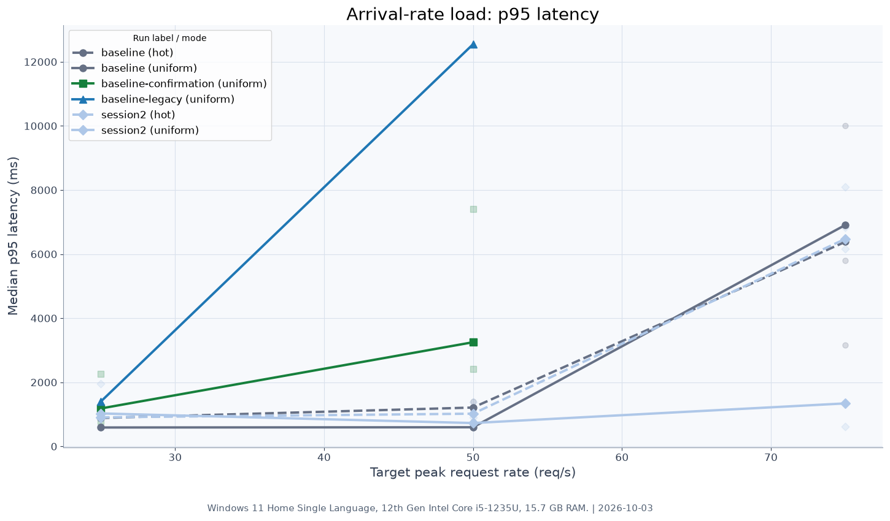
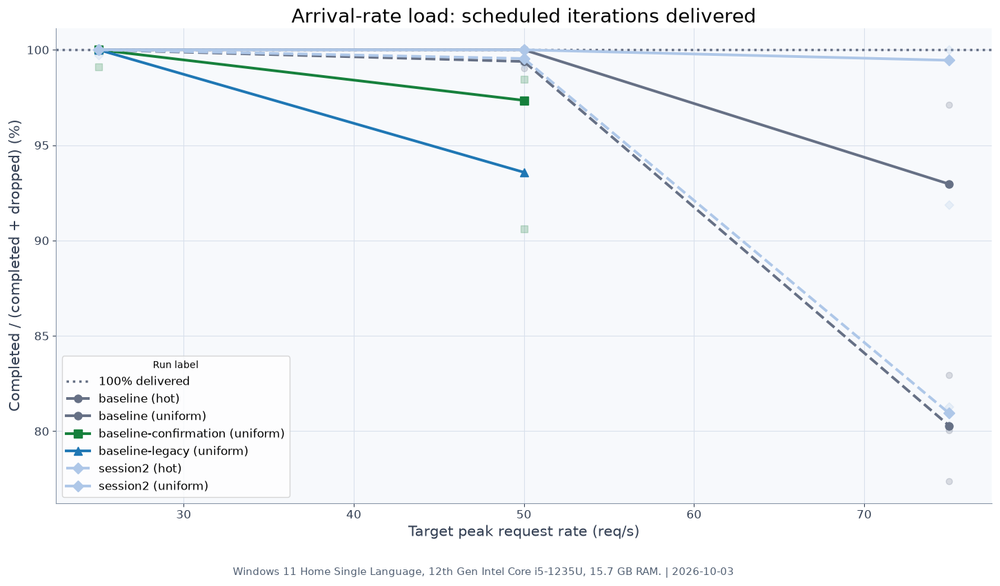
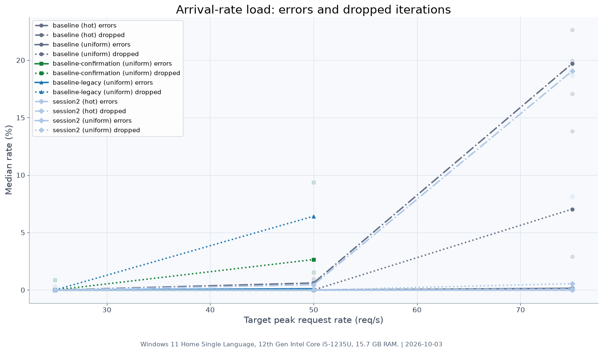
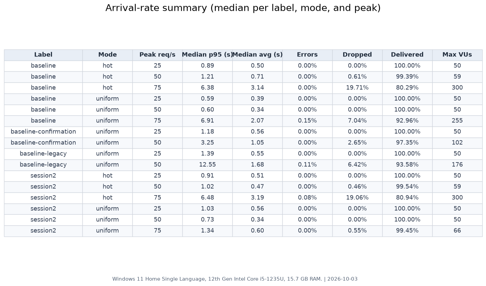
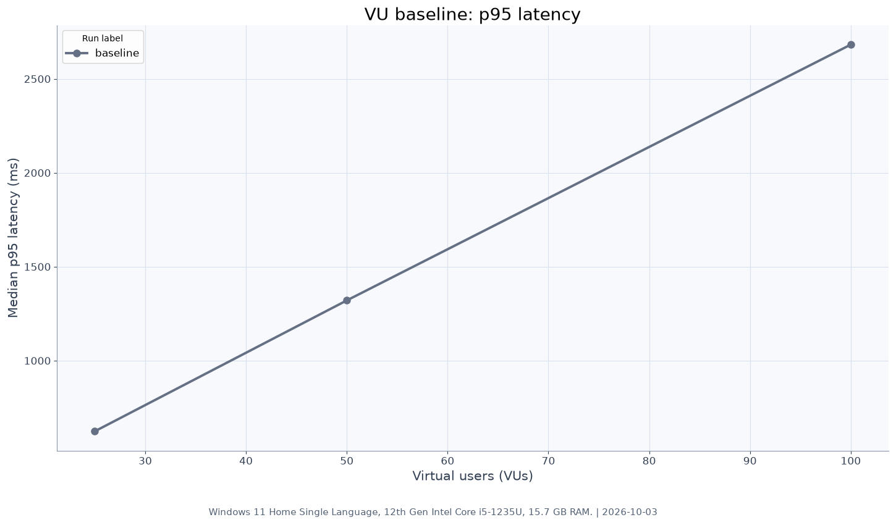
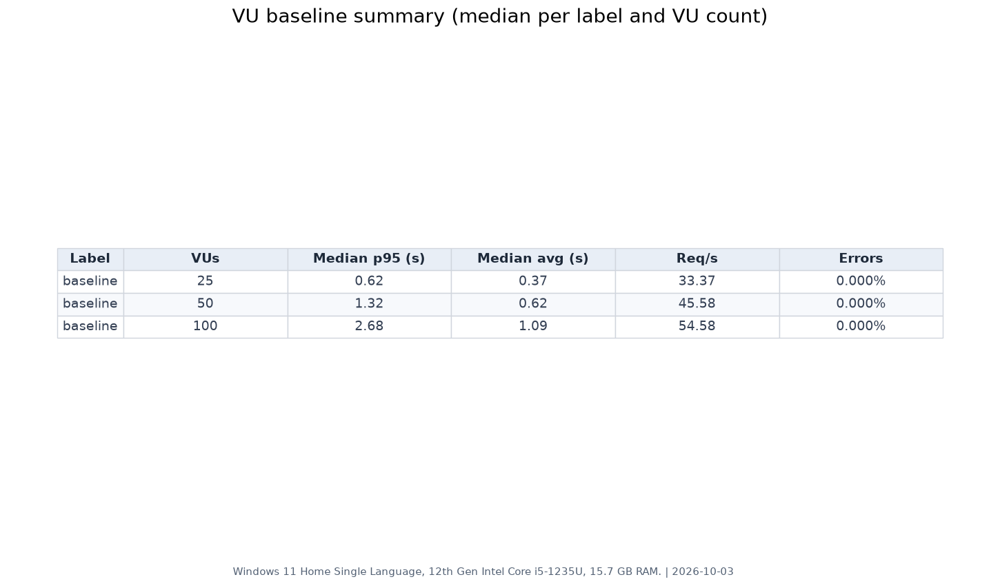

# Results

The naive profile delivered 50 req/s with a median p95 of 0.60 s in the latest uniform session. At 75 req/s, p95 reached 6.38 s in hot mode and 6.91 s in uniform mode, with 19.708% and 7.039% of arrivals dropped respectively; one uniform run recorded 13.814% errors with the 10 s client timeout. The baseline-legacy and baseline-confirmation results at 50 req/s (12.55 s and 3.25 s p95) are earlier, slower sessions kept for reference, and predate the timeout setting. The minimum observed latency is about 254 ms, most likely dominated by the round trip to Neon.

### Arrival-rate tests

These charts compare latency, delivered arrivals, errors/drops, and the per-mode summary.






### Fixed-user tests

These charts show p95 latency, throughput, and the fixed-user summary across VU levels.





**Test conditions:** Windows 11 Home Single Language, 12th Gen Intel Core i5-1235U, 15.7 GB RAM; naive profile; Neon shard primaries; 10 s client timeout for hot and uniform arrival runs.

See [summary.md](summary.md) for the full tables.

# Naive read baseline run record

## Environment used for the initial baseline

- Service launch: packaged JAR, started with `.\scripts\start-read.ps1` from the repository root.
- Effective Java command: `java -Xms128m -Xmx512m -jar .\result-read-service\target\result-read-service-0.0.1-SNAPSHOT.jar`
- JVM flags: `-Xms128m -Xmx512m`
- Java: Temurin OpenJDK `25.0.4.1`; the project compiles for Java 21.
- Spring profile: `naive`.
- Datasources: reads route to the two Neon shard primary URLs; the read replicas are not used.
- Redis for Phase 1: not used; these tests involve no Docker or Upstash Redis instance or Redis region. Redis is reserved for later cache/state scope.
- HikariCP: default configuration, no pool-size overrides. HikariCP's default `maximumPoolSize` is 10 per shard pool and, when unset, `minimumIdle` defaults to the maximum. The observation script reads and prints the effective `maximumPoolSize` from Actuator before its run; record that output with the measurements.
- Machine: Windows 11 Home Single Language, 12th Gen Intel Core i5-1235U, 15.7 GB RAM.
- k6: `v2.2.0 (commit/00a9a1b7f5, windows/amd64)`.
- Initial run date: 2026-10-01.
- Latest session: 2026-10-02, laptop plugged in, best performance.

## How to reproduce

1. Ensure the root `.env` contains the two shard primary URLs. Do not print, commit, or share it.
2. Build the JAR from the repository root:

   ```powershell
   .\api-gateway\mvnw.cmd -B -f .\result-read-service\pom.xml -DskipTests package
   ```

3. Start the service and leave that PowerShell window open:

   ```powershell
   .\scripts\start-read.ps1
   ```

4. In another PowerShell window, run the controlled warmed repetitions:

   ```powershell
   .\load-tests\k6\run-baseline.ps1 -Profile naive
   ```

   This warms one seeded roll number on each shard five times before every run,
   runs 25, 50, and 100 VUs three times each, waits 20 seconds between
   repetitions, and writes per-run k6 JSON summaries plus the combined
   `load-tests\results\naive\summary.md` report. Raw k6 JSON exports are
   written under `load-tests\results\naive\raw\`.

The naive and optimized comparisons must use the same machine, Java runtime,
JVM flags, k6 version, shard database setup, load profile, warm-up procedure,
and test timing. Report those conditions with both result sets. The initial
`raw/baseline-25.json`, `raw/baseline-50.json`, and `raw/baseline-100.json` are
historical unwarmed runs and are intentionally preserved separately from the
repeated warmed runs.

## Optional Hikari observation

The service exposes Actuator metrics read-only; no pool behavior or size is
changed. After rebuilding/restarting the service, run:

```powershell
.\load-tests\k6\run-hikari-observation.ps1 -Profile naive
```

It samples `hikaricp.connections.pending` and
`hikaricp.connections.active` every two seconds during one 100-VU run and
writes `load-tests\results\naive\raw\hikari-100.csv`.

## Fixed arrival-rate spike scenario

The separate `read-arrival.js` test offers a fixed request arrival rate:
20 seconds ramping to 25% of PEAK, 5 seconds to PEAK, 30 seconds holding
PEAK, then 5 seconds ramping to zero. The runner defaults to peaks of 25, 50, and 75 requests/second, three runs
each. `MODE` defaults to `uniform`, matching the original behavior: about 95%
of requests choose a random valid roll number and about 5% use an invalid key.
`MODE=hot` instead sends about 95% of requests to a deterministic `HOT_SET`
(default 3000) of valid roll numbers sampled at even intervals across the full
manifest key space, covering all listed colleges and both shards. `TIMEOUT`
defaults to 30 seconds; timed-out requests count as request errors.

Unlike a VU-based test, the offered
request rate does not decrease just because the service slows down; this
models students continuing to arrive during a result-day spike. `MAXVUS`
(default 300) caps concurrent VUs and therefore the number of concurrent
in-flight requests k6 can sustain. At high latency, this cap can prevent k6
from starting all scheduled iterations; k6 reports those as
`dropped_iterations`. This is part of the measured result and is reported, not
hidden.

From the repository root, run the default repeated baseline:

```powershell
.\load-tests\k6\run-arrival.ps1 -Profile naive
```

To choose peaks, mode, timeout, repeat selected rates, or stop immediately
after any run crosses a breaking-point threshold:

```powershell
.\load-tests\k6\run-arrival.ps1 -Profile naive -Peaks 25,50,75 -Runs 3 -Label baseline -Mode uniform -Timeout 10s
.\load-tests\k6\run-arrival.ps1 -Profile naive -Peaks 25,50,75 -Runs 3 -Label baseline -Mode hot -Timeout 10s
```

Use `-Profile optimized` when running the same tests against the optimized
service. Each profile writes only to its matching results directory.

Naive and optimized comparisons must use the same arrival script, PEAK values,
MAXVUS, machine, Java/JVM setup, k6 version, shard database setup, warm-up,
and run timing. The report is regenerated from matching
`<label>-<mode>-arrival-<peak>-run<run>.json` files under
`load-tests/results/<profile>/raw/` by the runner. Older
arrival result names without an explicit mode are treated as `uniform` and
legacy baseline files are labeled `baseline-legacy` in the report.

## Reports and dashboard exports

Both load-test runners export a self-contained k6 dashboard HTML file under
`load-tests/results/<profile>/html/` for each repeated run. They temporarily
enable
`K6_WEB_DASHBOARD` and `K6_WEB_DASHBOARD_EXPORT` and restore their previous
values when the run finishes or fails. `load-tests/report/make_report.py`
reads only repeated JSON files under `load-tests/results/<profile>/raw/`
matching `-run<i>.json`, then regenerates
`summary.md` and PNG comparisons under `load-tests/results/<profile>/charts/`.
Pass `--profile naive` or `--profile optimized` when running the report directly.
The historical unwarmed `raw/baseline-25.json`, `raw/baseline-50.json`, and
`raw/baseline-100.json` files are left untouched and excluded.
