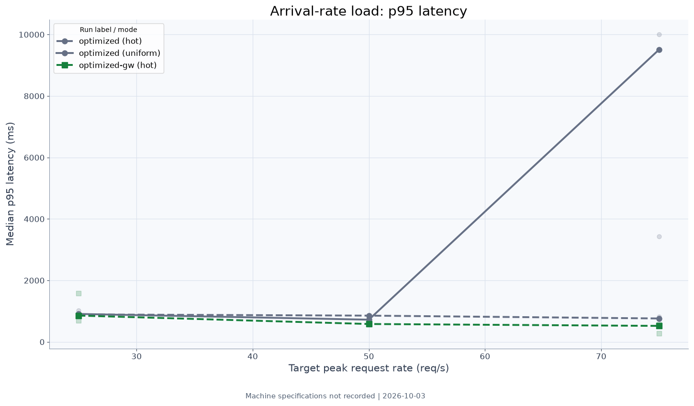
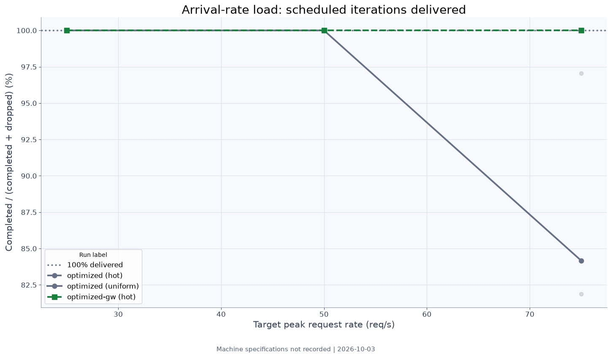
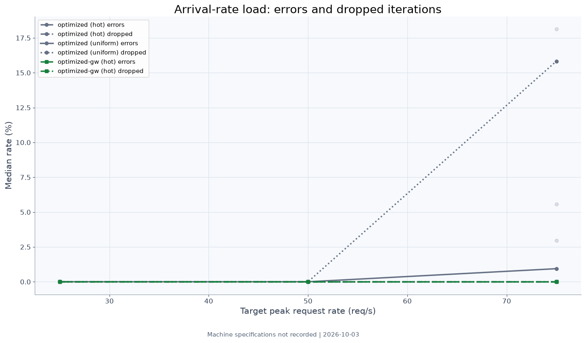
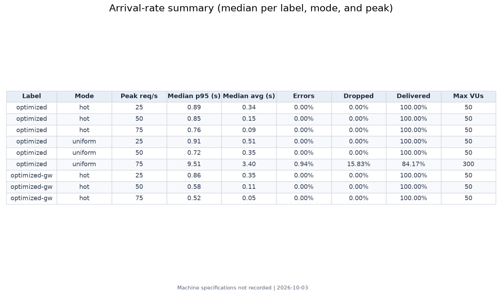

# Optimized profile results

The optimized profile adds Redis cache-aside, negative caching, per-key
stampede protection, and replica reads. In hot mode, its reported medians
delivered 100% of scheduled arrivals with no errors or dropped iterations at
25, 50, and 75 req/s. Uniform mode had no consistent cache benefit, and the
75 req/s run was not better than the naive profile.

## Arrival-rate charts

## Reported medians

Latency values are seconds. These values are copied from [summary.md](summary.md).

| Label | Mode | Peak req/s | Median p95 | Median average | Errors | Dropped iterations | Delivered |
|---|---|---:|---:|---:|---:|---:|---:|
| optimized | hot | 25 | 0.89 | 0.34 | 0.000% | 0.000% (0) | 100.00% |
| optimized | hot | 50 | 0.85 | 0.15 | 0.000% | 0.000% (0) | 100.00% |
| optimized | hot | 75 | 0.76 | 0.09 | 0.000% | 0.000% (0) | 100.00% |
| optimized | uniform | 25 | 0.91 | 0.51 | 0.000% | 0.000% (0) | 100.00% |
| optimized | uniform | 50 | 0.72 | 0.35 | 0.000% | 0.000% (0) | 100.00% |
| optimized | uniform | 75 | 9.51 | 3.40 | 0.938% | 15.828% (461) | 84.17% |
| optimized-gw | hot | 25 | 0.86 | 0.35 | 0.000% | 0.000% (0) | 100.00% |
| optimized-gw | hot | 50 | 0.58 | 0.11 | 0.000% | 0.000% (0) | 100.00% |
| optimized-gw | hot | 75 | 0.52 | 0.05 | 0.000% | 0.000% (0) | 100.00% |

The optimized-gw runs went through the API gateway. Its rate limit was raised
to 1000 requests/s with a burst capacity of 2000 for k6's single source IP,
using the gateway's load-test startup mode.

**Test conditions:** the arrival tests used a 10 s client timeout. The gateway
tests used the raised rate limit; raw k6 JSON exports are in `raw/`, and the
combined tables are in [summary.md](summary.md).

Raw k6 JSON results and any Hikari CSV observation are stored under `raw/`;
HTML dashboard exports remain under `html/`. Use the shared load-test scripts
with `-Profile optimized`.
